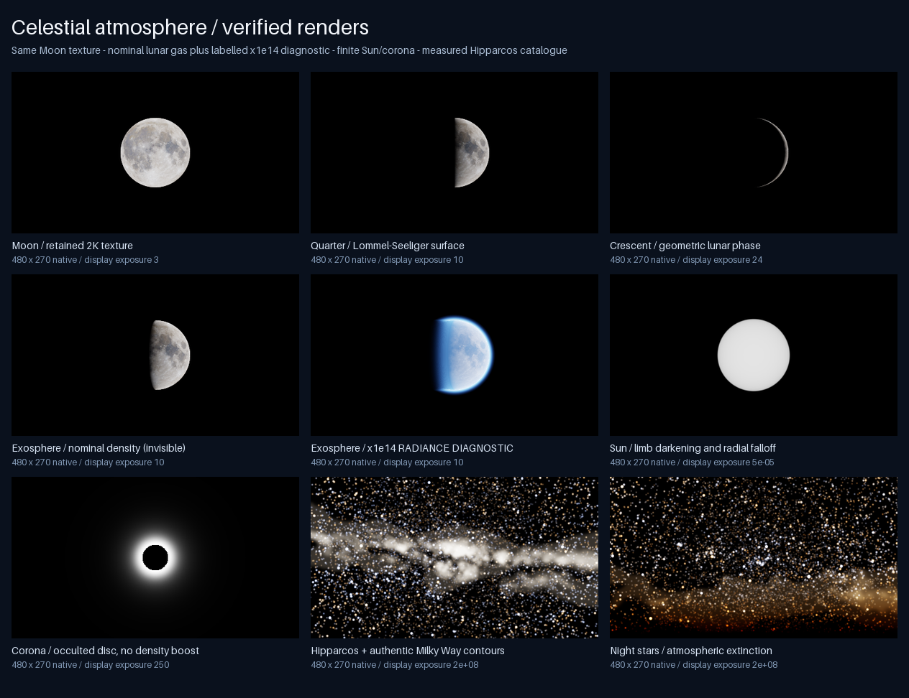

# Celestial atmosphere — executed experimental rendering

**Implemented and rendered, not a requirements-only proposal.** The prototype is isolated in
[`Experimental/CelestialAtmosphere`](../../Experimental/CelestialAtmosphere/README.md). Thirty actual 480x270
Slang/Vulkan captures cover the requested six skies, both atmospheric viewpoints, Moon, Sun and five lens types.
This is Linux GCC/SwiftShader **CPU Vulkan**, not Windows, physical-GPU or production-editor acceptance.

[Capture viewer](Celestial.html) · [celestial overview](Images/CelestialOverview.png) ·
[six skies](Images/SkyStates.png) · [five flares](Images/FiveFlares.png)



## Requirement verification

| Requirement                 | Executed verification / observed result                                   |
| --------------------------- | ------------------------------------------------------------------------- |
| Same Moon texture           | Same 2K JPEG; linear-light filtering; image-sample error 5.52e-6          |
| Lunar atmosphere            | Nominal gas max radiance 5.54e-15; labelled x1e14 diagnostic              |
| Lunar phase / opacity       | Lit area 1 / .5 / .05515 vs geometric 1 / .5 / .05450                     |
| Sun / solar atmosphere      | Finite disc, radial edge, chromosphere and quiet Thomson corona           |
| Solar radial falloff / flux | Profile error 2.63e-7; unit irradiance integrates to .99993228            |
| Five flare types            | Ghosts, diffraction, anamorphic streak, antipode halo, veiling glare      |
| Flare addition / blocking   | Image addition error 5.96e-8; fully occluded source exactly black         |
| Atmosphere viewpoints       | Six pairs: 400 km orbit and 1.64 km surface-observer altitude             |
| Six named skies             | Before sunrise -10, dawn -4, sunrise 0, zenith +90, sunset 0, dusk -6 deg |
| Earth atmosphere            | Rayleigh/aerosol/ozone; transmission error .002490, gate .007             |
| Surface/orbit scattering    | 3,282 total GPU physics probes; relative error .001421, gate .04          |
| Proper stars                | 41,359 measured rows; all 8,080 field sources match retained stars        |
| Star photometry             | Projection error 7.71e-5 px; image-flux relative error 9.52e-9            |
| Star direction accuracy     | Rendered field vs Astropy max .006134 deg; 6,228-case max .007170 deg     |
| Galaxy accuracy             | Astropy rotation vector error 2.14e-7; weighted mean abs(b) 5.256 deg     |
| Sun / Moon ephemerides      | 960 DE421 cases: Sun max .012497 deg; Moon max .003118 deg                |
| Slang execution             | Ten compiled AND executed entries; eight SSBOs / 128-byte pushes          |
| Native / sanitizer tests    | Release 2/2, ASan+UBSan 2/2, Vulkan-OFF 1/1 CTests; 51,899 assertions     |
| Capture viewer              | All 30 views, 7 isolated flare planes, keyboard and mobile checks pass    |
| Viewer evidence rejection   | Missing capture manifest and changed-image controls rejected              |
| Regression sensitivity      | Broken optical trig, ground boundary and polar closure rejected           |

Dawn is deliberately **before** sunrise: the six requested names are not six equally spaced clock labels.
Sunrise/sunset use the **geometric solar centre**, without apparent refraction or upper-limb timing. The +90°
zenith fixture uses that date's subsolar latitude, explicitly not Benoni. Other named skies use Benoni on
2026-11-18, with UTC solved from the actual engine ephemeris. Dates, directions, altitude and exposure are retained.
Surface/orbit Moon positions include the corresponding topocentric observer height.

## Models and honest limits

- The Moon has a **tenuous exosphere**, not a visible blue Earthlike atmosphere. The physical-scale capture
  keeps nominal Rayleigh-scale coefficients and is effectively invisible. The blue x1e14 view is a labelled
  **radiance diagnostic**, not a physical-density prediction. The 50 km exponential profile is representative;
  no measured LADEE inversion, sodium-line emission, time-varying chemistry or full collisionless model is claimed.
- Lunar texture, phase dimming, earthshine and approximate optical libration are the reused engine's visual
  approximations. The closeups have prescribed full/quarter/crescent geometry; they are not photographs of the
  Moon on the named capture date. Reflectance and third-party Moon redistribution rights remain uncalibrated /
  independently unconfirmed. See the retained
  [Moon provenance](../../EngineContent/CelestialMaps/MoonAlbedoProvenance.md).
- Earth's single scattering is independently integrated; multiple scattering is a local directional-average
  isotropic closure. Numerical agreement is **not** a measured-sky colour/brightness validation. The spherical
  Lambertian ground has no Earth surface map, clouds, terrain, weather, airglow or light pollution.
- The Sun's corona uses a quiet radial density law and Thomson scattering. The chromospheric RGB profile is
  illustrative, not a spectral magnetohydrodynamic plasma simulation. A coronagraph mask and longer **exposure**
  reveal the corona without changing its density. Lens coefficients are parametric and unmeasured.
- The Milky Way uses real Jose R. Vieira/d3-celestial contours with assigned surface brightness and smoothing,
  not a measured HDR panorama. Stars are real Hipparcos/XHIP entries, not random decorative particles.
  First-order precession / UTC≈UT1 omit proper motion, nutation, atmospheric refraction and stellar parallax.
- No production renderer/editor wiring, cloud coupling, scene moonlighting, lens calibration, physical GPU,
  Windows/MSVC run or real-time acceptance. Existing shadow/GI failed quality/speed gates and emissive-sphere-only
  retained shadow scenes are unchanged. This celestial experiment does not supersede those conclusions.

## Executed checks and defect chronology

| Defect caught before delivery         | Repair / unchanged regression gate                                     |
| ------------------------------------- | ---------------------------------------------------------------------- |
| Generic ICD sine at milliradian limbs | Bounded Float32 optical trig; solar gate 2e-5, final error 2.63e-7     |
| Lunar pixel projection near the limb  | Same stable small-angle sine; image error 0.002411 → 5.52e-6           |
| Rounded planet boundary at deep night | Opaque interior/inward boundary, normalized directions, valid interval |
| Circumpolar rings closed as flat art  | Close winding outer/hole rings at the same pole; Astropy plane gate    |

The first full-image review was **not accepted**: twilight ground and the night star view exposed a sunlight leak
missed by initial daytime probes. Deep-night full-image/table checks now pass, and deliberate reintroduction is
rejected. The old planar galaxy closure placed 12.6% of assigned light beyond \|b\|=20°; correct closure reduces it
to 0.0777%, below the unchanged 1% gate. Negative-control source/SPIR-V hashes and actual failure stderr are retained.

The native reference also initially treated a ray/sphere miss sentinel as a valid ground intersection; corrected
before acceptance. A blanket RGB extinction-order assertion was invalid in ozone-dominated high-altitude air;
replaced with transmission bounds plus the explicitly low-altitude Rayleigh-order check. Neither was hidden by
relaxing the independent optical-depth, scattering, solar-profile or lunar-image gates.

## Retained evidence

| Path                               | Contents                                                                        |
| ---------------------------------- | ------------------------------------------------------------------------------- |
| `Images/*.png`                     | 30 native captures, 7 isolated flare planes, 3 sheets, 1 browser screenshot     |
| `Captures.json`                    | Per-view source, camera, directions, dimensions, gain, exposure and hashes      |
| `Results/CelestialVulkan.json`     | Actual device, 3,282 probes, ten entries, 33.9 million numeric/pixel assertions |
| `Results/CelestialInspection.json` | Independent full-image Moon / star-flux / galaxy / Sun checks                   |
| `Results/CelestialNumeric.json`    | 51,899 native assertions, analytic columns and phase normalization              |
| `Results/CelestialControls.json`   | Three deliberately broken variants rejected by current tests                    |
| `Results/NativeRadiance.npz`       | Exact Float32: 1,024 RGBA probes/layer/view, five full planes and all LUTs      |
| `Results/ProjectedStars.npz`       | All 8,080 projected stellar entries, lossless structured Float64 table          |
| `Results/ShaderAbi.json`           | All ten shader storage slots, 128-byte pushes and 64x1x1 groups                 |
| `Results/Integrity.json`           | Source, compiled SPIR-V, native executable and retained-file SHA-256            |
| `Results/StarCatalogue.txt`        | Fresh 6,228-case independent Astropy/ERFA comparison                            |
| `Results/Ephemeris.txt`            | Fresh 960-case DE421 comparison, kernel hash and library versions               |
| `Results/CelestialSanitized.txt`   | Actual ASan+UBSan configure/build and 2/2 CTests                                |
| `Results/CelestialFinalChecks.txt` | Final sanitizer rebuild / 2 CTests and Vulkan-OFF build / 1 CTest               |
| `Results/CelestialBrowser.json`    | Actual Chromium viewer interactions, mobile layout and rejection controls       |
| `Results/CelestialEvidence.json`   | Retained source/file hashes, Float32 sample and full-plane consistency          |
| `Results/Reproduction.txt`         | Tested tool versions, commands, source scope and unrun configurations           |

Full raw per-view output remains reproducible in ignored scratch; it is **not all duplicated in Git**.
The five full retained planes are full-Moon radiance, physical lunar gas, solar disc, corona and catalogue-only
stars. Every other view/layer has stratified lossless float probes plus its full native PNG. Display mapping is
fitted ACES followed by IEC sRGB, at the per-view photographic exposure; image sheets resize only for presentation.
The full-Moon output repeats bit-identically after all scene switches. No generated illustrations are evidence.

## Reproduction

Prerequisites: C++20, CMake, Ninja (or Make), Slang and Vulkan headers/loader/explicit driver. Python 3.11 with
`Requirements.txt` is the tested validation environment; install dependencies in an environment outside Git.
No runtime network is needed; the pinned DE421 wheel and bundled IERS data supply the independent reference.

```bash
python3 -m pip install -r Exhibits/CelestialAtmosphere/Requirements.txt
export VULKAN_DRIVER=/absolute/path/to/libvk_swiftshader.so
export SLANGC=/absolute/path/to/slangc
# If Vulkan is not discoverable through the SDK:
export VULKAN_INCLUDE_DIR=/absolute/path/to/Vulkan-Headers/include
export VULKAN_LIBRARY=/absolute/path/to/libvulkan.so.1
bash Exhibits/CelestialAtmosphere/RunCelestial.sh
python3 Exhibits/CelestialAtmosphere/Code/ValidateCelestialEvidence.py Exhibits/CelestialAtmosphere
```

The Bash launcher uses a single-configuration CMake build and accepts `CMAKE`, `CTEST`, `PYTHON`, `CXX`, `BUILD`,
`INPUTS`, `OUTPUT`, `RETAIN`, `JOBS` and `CMAKE_MAKE_PROGRAM` overrides. On Windows, use the corresponding Slang,
Vulkan SDK and driver library with CMake / Ninja or Git Bash; that configuration has **not** been run here.
No Linux executable or replacement Windows binary is shipped.

For ASan+UBSan, use a separate GCC/Clang Debug build with
`-fsanitize=address,undefined -fno-omit-frame-pointer`; the tested Linux build also uses `-fno-pie` / `-no-pie`.
Run `ctest --test-dir <build> --output-on-failure -j 1` with `ASAN_OPTIONS=detect_leaks=0` and
`UBSAN_OPTIONS=halt_on_error=1`. External Vulkan-driver leak checking is disabled; this is not a driver leak audit.
For native-only portability checks configure `-DFRONTIER_CELESTIAL_VULKAN=OFF` with prepared inputs.

To serve the retained capture viewer, run `python3 Experimental/CelestialAtmosphere/Preview.py --port 4176`.
The optional browser verification needs Node.js, `playwright-core` and Chromium, provisioned outside Git:

```bash
CHROMIUM_EXECUTABLE=/absolute/path/to/chromium \
  node Exhibits/CelestialAtmosphere/Code/ValidateCelestialPresentation.cjs http://127.0.0.1:4176
```

Set `NODE_PATH` if `playwright-core` is not in Node's normal search path. The browser test records a screenshot
and report; run it before the final inspector/integrity refresh when regenerating retained delivery evidence.

`Results/Reproduction.txt` records the actual tested tool versions, source base and commands. The exact uncommitted
implementation at capture time is identified by SHA-256, rather than pretending the base commit contains the new code.
All new changes are committed only after these checks; no Actions run is requested or required.
