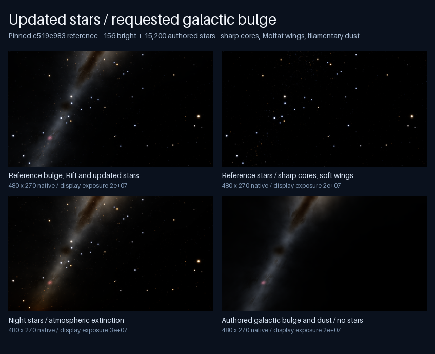
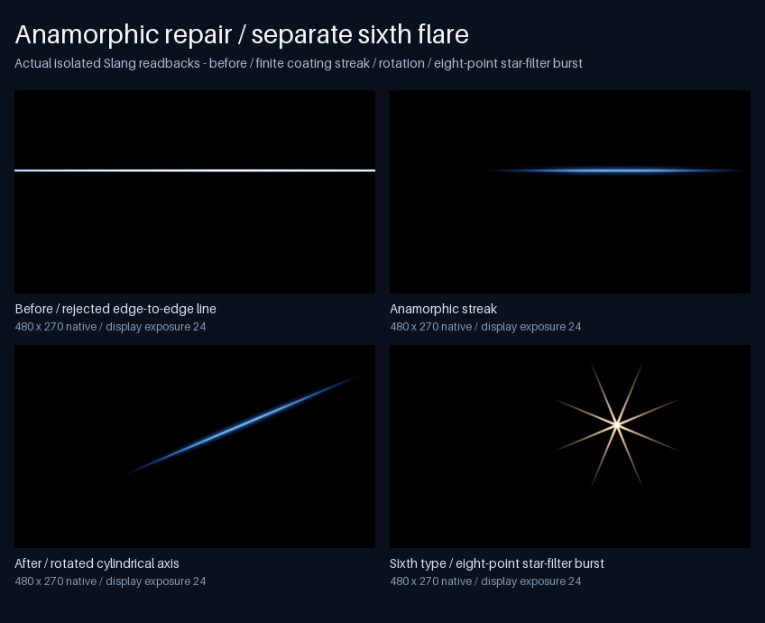

# Celestial atmosphere — executed experimental rendering

**Implemented and rendered.** The requested reference Milky Way, all four night presentations, repaired anamorphic
streak and distinct sixth starburst are implemented in
[`Experimental/CelestialAtmosphere`](../../Experimental/CelestialAtmosphere/README.md).
There are **32 native 480x270 views plus three focused optical diagnostics**, generated by C++ / Slang / Vulkan.
This is Linux GCC / SwiftShader **CPU Vulkan**, not Windows, physical-GPU or production-editor acceptance.

[Capture viewer](Celestial.html) · [updated night skies](Images/UpdatedNightSkies.png) ·
[anamorphic before/after](Images/AnamorphicRepair.png) · [six flares](Images/SixFlares.png) ·
[six skies / two viewpoints](Images/SkyStates.png)



## Requested follow-up

| Request                  | Implemented result                                                                |
| ------------------------ | --------------------------------------------------------------------------------- |
| Copy preferred Milky Way | Actual native bulge/dust/nebular model from the requested branch, ported to Slang |
| Update all four views    | Reference stars-only, stars+galaxy, surface night and galaxy-only views           |
| Update star catalogue    | Source's 156 bright entries + 15,200 explicitly authored deep-field points        |
| Keep accuracy honest     | Original 41,359 measured Hipparcos rows preserved in a separate validation view   |
| Repair anamorphic flare  | Finite taper, softer blue transverse bloom, pixel-area coverage and axis rotation |
| Add sixth starburst      | Separate eight-point star filter; existing six-ray aperture diffraction retained  |

Requested source: `SultanAladin/Frontier`, branch `arena/a1dad11b-frontier`, immutable revision
`c519e983110100a9ed1c17bd3ff97a1c27bef3b9`. The adaptation retains its quintic lattice hash, rotated fBm,
thin/thick disc, warm bulge, clumpy star clouds, Great Rift/Coalsack, warped filamentary dust/reddening and seven
nebular/satellite profiles. Its original [1280x720 reference image](Images/ReferenceGalacticBulge.png) is retained
byte-identically and is **not** represented as a local capture. This is a source-model port, not a pasted sky PNG.
The local composition uses the reference's site/sidereal direction and field of view, with the engine's existing
first-order precession. It does not copy the reference's atmosphere, auto-metering, resolution or display pipeline.

The four updated presentations select the reference field instead of stacking it over Hipparcos. **15,200 authored
stars are not 15,200 new measurements.** Bright reference coordinates are rounded. The measured-only diagnostic
keeps the original catalogue and strict original Gaussian flux/astrometry checks unchanged.
The older Vieira/d3-celestial contours remain an orientation/negative-control fixture, not the visible galaxy.

## Focused verification

| Check                                         | Observed result                                             |
| --------------------------------------------- | ----------------------------------------------------------- |
| Compile actual pinned upstream evaluator      | 8 original source identities; 5 byte-identical exports      |
| Galactic bulge/dust vs original native source | 517 probes; max absolute RGB error 4.77e-7                  |
| Nebulae/satellites vs original native source  | 119 probes; max absolute RGB error 3.43e-7                  |
| Stellar PSF vs original native source         | 121 probes; max absolute error 8.95e-8                      |
| Updated rendered star correspondence          | 3,464 / 3,464 match source coordinates, flux and provenance |
| Updated field split                           | 34 bright references + 3,430 authored points projected      |
| Updated GPU projection                        | Maximum 6.07e-5 pixels                                      |
| Independent Gaussian/Moffat image integration | Relative maximum image error 4.45e-7                        |
| Finite-support stellar image flux             | Relative error 2.62e-8 vs independent finite integral       |
| Anamorphic defect reproduced                  | Rejected legacy edge/peak ratio 0.267174                    |
| Anamorphic repair                             | Edge/peak ratio 0.001094; gate below 0.01                   |
| Axis rotation                                 | Requested 0.4 rad; measured 0.3999999906 rad                |
| Half-pixel source movement                    | Integrated radiance change 2.79e-6                          |
| Sixth vs original diffraction                 | Eight vs six rays measured in native images                 |
| Six-component full-image addition             | Maximum absolute error 5.96e-8; occluded RGB exactly zero   |

The reference PSF is **82% Gaussian**, sigma .62 px, plus **18% Moffat**, alpha 2.4 px / beta 2.5.
The Gaussian uses analytic pixel integration; the Moffat uses four-node Gauss-Legendre quadrature per axis.
Independent inspection reconstructs the entire image using eight nodes per axis. The finite **25x25 support omits
0.0912–0.0921%** of the infinite profile's flux; the finite integral is not mislabelled infinite-support conservation.
The separate measured-only Gaussian view retains its original 9.52e-9 full-image relative flux error.



The anamorphic defect was both excessively slow longitudinal decay and high display saturation, with centre-only
sampling of a thin cross-axis profile. Reducing exposure alone would not fix its shape. The repair has finite,
tapered reach, softer blue bloom and 4x4 pixel coverage, and disables the old anamorphic payload to avoid doubling it.
The normalized edge/peak comparison uses the **same exposure of 24**, so it does not hide the line by dimming the image.

## Preserved celestial requirements and regressions

| Requirement / check                         | Observed result                                                       |
| ------------------------------------------- | --------------------------------------------------------------------- |
| Same Moon texture                           | Same 2K JPEG; full-image linear-light sample error 5.52e-6            |
| Lunar atmosphere                            | Physical nominal gas max radiance 5.54e-15; labelled x1e14 diagnostic |
| Lunar full / quarter / crescent lit area    | 1 / .5 / .05515 vs geometry 1 / .5 / .05450                           |
| Finite Sun / radial falloff / corona        | Solar profile error 2.63e-7; integrated irradiance .99993228          |
| Earth Rayleigh / aerosol / ozone            | Transmission error .002490, gate .007                                 |
| Surface / orbit single scattering           | Relative error .001421, gate .04                                      |
| Six exact sky names                         | Before sunrise, Sunrise, Dawn, Zenith, Sunset, Dusk                   |
| Surface / space                             | All six at 1.64 km and 400 km observer altitude                       |
| Measured catalogue preservation             | All 8,080 projected Hipparcos entries match retained rows             |
| Measured direction accuracy                 | Rendered Astropy max .006134 deg; 6,228-case max .007170 deg          |
| Galactic-coordinate orientation             | Astropy rotation vector error 2.14e-7                                 |
| Sun / Moon independent ephemerides          | 960 DE421 cases; Sun max .012497 / Moon max .003118 deg               |
| Release / sanitizer / native-only builds    | 2/2 / 2/2 / 1/1 CTests; 53,954 native assertions                      |
| Actual shader execution                     | 10 entries; 4,423 probes; eight guarded SSBOs; 128-byte pushes        |
| Browser                                     | 32 views, 8 isolated planes, mobile/keyboard/integrity checks         |
| Deliberate defective variants               | All six negative controls rejected                                    |

Thirteen preserved PNGs are byte-identical to the delivered `ddb62b0` baseline, including the same Moon, Sun,
unchanged optical terms and original measured-only stars. `Results/CelestialContinuity.json` records each identity.

The native capture execution makes 38,170,660 numeric/pixel assertions; millions of pixels are **not independent
physics comparisons or measured-sky validation**. The sanitizer build's ten SPIR-V outputs are byte-identical to
Release. Driver leak checking is disabled; the sanitizer result is not a driver leak audit.

Dawn is before sunrise. Actual prescribed solar-centre elevations are -10 / 0 / -4 / +90 / 0 / -6 degrees in the
requested name order. Sunrise/sunset omit refraction and upper-limb timing. Zenith uses an explicitly ideal
subsolar site, not Benoni noon; the other named skies use the Benoni ephemeris on 2026-11-18.
The reference night composition has separately prescribed sidereal geometry and -32-degree Sun, not a claim to
photograph Benoni at that instant. Surface and orbit Moon positions use their corresponding topocentric height.

### Regression sensitivity and retained failures

- Generic optical trig, rounded planetary-boundary sunlight leakage and planar polar-contour closure are still
  deliberately reintroduced and rejected. Their original failures are not erased by the appearance revision.
- Removing the requested galactic dust fails comparison against the **actual original upstream evaluator**.
- Substituting the actual legacy anamorphic capture fails the repair's image gate.
- Substituting six-ray diffraction for the sixth starburst fails the native eight-vs-six image gate.
- The earlier sphere-miss sentinel, small-angle optical errors and polar-contour closure errors were repaired
  before the baseline delivery. Original bad planar closure placed 12.6% of outline light beyond |b|=20 degrees;
  retained correct closure is 0.0777%, below the unchanged 1% check. Contours no longer provide visible photometry.
- Historical shadow/GI quality and performance failures and the retained emissive-sphere-only shadow scenes are
  untouched. This celestial experiment does not supersede those conclusions.

## Retained evidence and limits

| Path                                         | Contents                                                             |
| -------------------------------------------- | -------------------------------------------------------------------- |
| `Captures.json`, `Images/*.png`              | 32 views, 8 isolated lens images, 3 diagnostics and sheets           |
| `Results/ReferenceSourceValidation.json`     | Original pinned evaluator compilation and export identity results    |
| `Results/Reference*.csv`                     | Original exports plus 757 actual GPU/native source-model probe pairs |
| `Results/CelestialInspection.json`           | Full-image star, Moon, Sun, anamorphic and starburst checks          |
| `Results/CelestialVulkan.json`               | Device, execution, physics, per-capture directions and timings       |
| `Results/CelestialNumeric.json`              | Native analytic columns, phases and six-component optical checks     |
| `Results/CelestialControls.json`             | Six rejected variants, actual errors and modified identities         |
| `Results/NativeRadiance.npz`                 | 1,024 RGBA probes per layer/view/diagnostic; five full planes/LUTs   |
| `Results/ProjectedStars.npz`                 | Measured and reference stellar readback tables, lossless Float64     |
| `Results/ShaderAbi.json`, `Integrity.json`   | Reflection, source, SPIR-V, executable and retained-file hashes      |
| `Results/CelestialSanitized.txt`             | Fresh sanitizer 2/2, Vulkan-OFF 1/1 and shader-identity comparison   |
| `Results/StarCatalogue.txt`, `Ephemeris.txt` | Fresh independent Astropy and DE421 comparisons                      |
| `Results/CelestialBrowser.json`              | Actual Chromium interaction/mobile/rejection checks                  |
| `Results/Reproduction.txt`                   | Tested tools, commands, source scope and unavailable configurations  |

The five full retained planes are full Moon, nominal lunar gas, solar disc, corona and **measured-only** stars.
All other planes have lossless Float32 samples, full native PNGs and reproducible raw-image generation.
Display is fitted ACES then IEC sRGB at declared photographic exposure. Sheets resize captures only for presentation;
no AI-generated imagery, browser sky renderer or invented measurement is used as evidence.

The lunar gas profile is representative, not a measured collisionless LADEE inversion, and is effectively invisible.
Its blue x1e14 view amplifies **radiance only**, not physical density. Lunar BRDF, optical libration, chromospheric
colour and local multiple-scattering closure remain approximations. Galaxy/deep stars and lens coefficients are
authored, not calibrated observations. Proper motion, nutation, refraction and stellar parallax are absent.
No Windows/MSVC, physical GPU, editor, device-local/asynchronous, real-time or production integration is claimed.
[Content provenance and ownership qualifications](../../Experimental/CelestialAtmosphere/Content/Provenance.md)
remain explicit; public source access is not a new redistribution/relicensing grant.

## Reproduction

Prerequisites: C++20, CMake, Ninja or Make, Slang, Vulkan headers/loader/explicit driver, and Python 3.11 with
`Requirements.txt`. `gh` provisions the eight pinned upstream sources outside Git on first reproduction;
subsequent runs can be offline. No GitHub Actions are used. The original-source probe is tested with GCC and GNU
section garbage collection; this additional probe has not been ported to MSVC. Rendering itself needs no network.

```bash
python3 -m pip install -r Exhibits/CelestialAtmosphere/Requirements.txt
export VULKAN_DRIVER=/absolute/path/to/libvk_swiftshader.so
export SLANGC=/absolute/path/to/slangc
# If Vulkan is not discoverable through the SDK:
export VULKAN_INCLUDE_DIR=/absolute/path/to/Vulkan-Headers/include
export VULKAN_LIBRARY=/absolute/path/to/libvulkan.so.1
bash Exhibits/CelestialAtmosphere/RunCelestial.sh
python3 Exhibits/CelestialAtmosphere/Code/ValidateCelestialEvidence.py Exhibits/CelestialAtmosphere
```

The launcher accepts `CMAKE`, `CTEST`, `PYTHON`, `CXX`, `BUILD`, `INPUTS`, `OUTPUT`, `RETAIN`, `JOBS`,
`CMAKE_MAKE_PROGRAM`, `REFERENCE_SOURCES` and `REFERENCE_OFFLINE=1`. Reference sources normally restore into ignored
`ExternalPackages/CelestialReference/<revision>/`. Native CMake / Ninja targets can be used separately on Windows
with the corresponding Slang and Vulkan libraries; that configuration has **not** been run here. No Linux
application package or substitute Windows binary is shipped.

For ASan+UBSan use a separate GCC/Clang Debug build with
`-fsanitize=address,undefined -fno-omit-frame-pointer`; this Linux environment also uses `-fno-pie` / `-no-pie`.
Run CTest with `ASAN_OPTIONS=detect_leaks=0 UBSAN_OPTIONS=halt_on_error=1`. For native-only checks configure
`-DFRONTIER_CELESTIAL_VULKAN=OFF` with prepared inputs.

Serve the retained viewer with `python3 Experimental/CelestialAtmosphere/Preview.py --port 4176`.
Browser checks require Node.js, `playwright-core` and Chromium, provisioned outside Git:

```bash
CHROMIUM_EXECUTABLE=/absolute/path/to/chromium \
  node Exhibits/CelestialAtmosphere/Code/ValidateCelestialPresentation.cjs http://127.0.0.1:4176
```

Set `NODE_PATH` if required. Run the browser check before the final inspector/integrity refresh because it writes a
screenshot and report. `Results/Reproduction.txt` records tested versions and the base commit; SHA-256 identities
identify the actual working source at capture time. Commit/push follows verification, without an Actions run.
