# Deterministic path tracer — WebGPU prototype validation

Evidence for [`Experimental/DeterministicPathTracer/`](../../Experimental/DeterministicPathTracer/README.md):
a compute-shader path tracer with **no** random numbers, Russian roulette or stochastic branch selection,
rendering the ControlVehicle (VehicleHMI / UV editor vehicle) in a material studio.

## Claim

| # | Claim | Test | Result |
|---|---|---|---|
| 1 | Every integration coordinate is a fixed, structured point, identical on GPU and host | `quadrature` | 147,456 GPU-vs-host coordinates, **0 mismatches** |
| 2 | Each 2-D quadrature pair is a (0,m,2)-net, so prefixes of 2^k samples are stratified | `quadrature` | 66 pairs, all nets up to 2^14; worst cross-pair correlation 0.044 |
| 3 | The estimator converges to the exact answer (no bias) | `analytic` | Softbox on a Lambert floor vs closed-form polygon irradiance: **RMS 0.034 %**, max 0.10 % at 1024 spp |
| 4 | Output is bit-exact on repeat, regardless of batching, reconfiguration or process | `determinism` | 5 runs (batch 1/4/32, after reconfig, 2nd browser): **1 distinct digest** `2dc6f6ca` |
| 5 | Error falls faster than Monte Carlo's N^-1/2 | `convergence` | Full Hero scene ≈ N^-0.76; analytic softbox ≈ N^-1 |

## Evidence

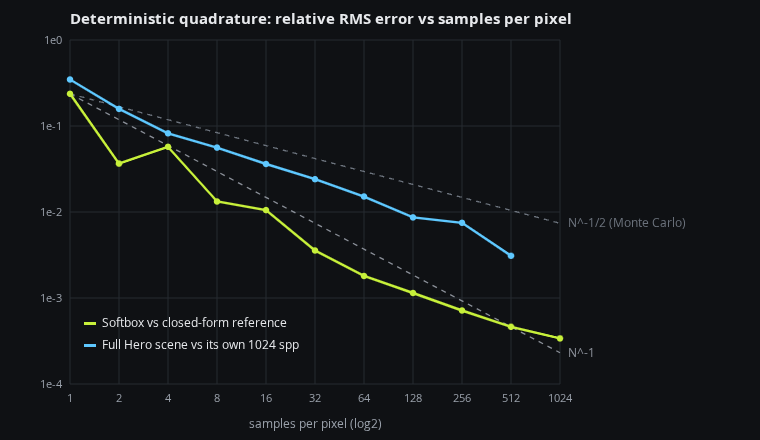

| Hero, 640×360, 128 spp | Material spheres, 128 spp | Rear, Racing paint, 64 spp |
|---|---|---|
| 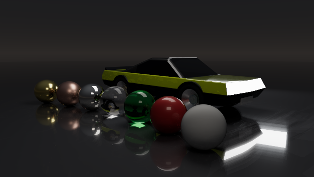 | 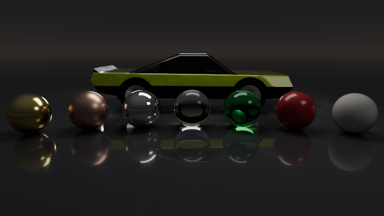 | 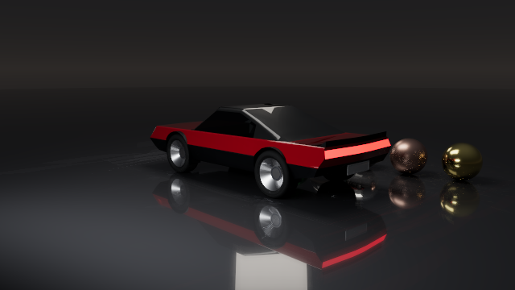 |

Progression (320×180) — structured, not grainy, at low counts:

| 1 spp | 4 spp | 16 spp | 64 spp |
|---|---|---|---|
| 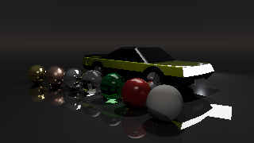 | 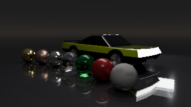 | 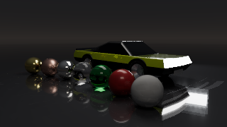 | 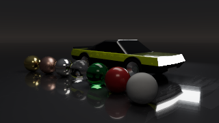 |

Interface (1440×860, render scale 0.4, 16 spp, `present=readback`):

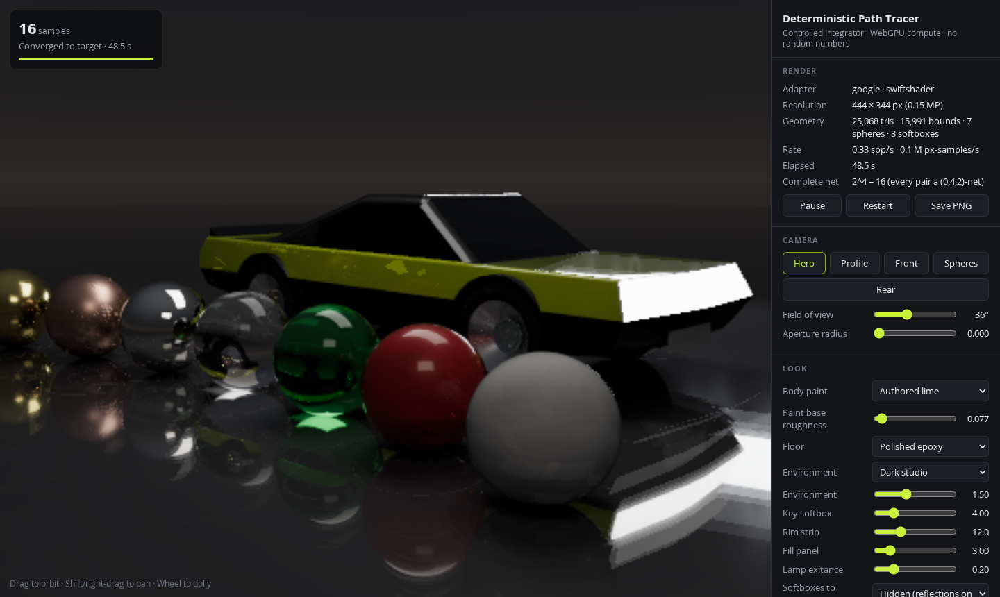

Raw numbers: `Results/*.json` (per-checkpoint curves, digests, worst pixel, timings). Capture digests:
Hero `b19096e3`, Spheres `938371a7`, Rear `fba37cb8`.

### Analytic test, relative RMS vs spp (160×120, key softbox only, one bounce)

| spp | 1 | 2 | 4 | 8 | 16 | 32 | 64 | 128 | 256 | 1024 |
|---|---|---|---|---|---|---|---|---|---|---|
| RMS | 2.4e-1 | 3.7e-2 | 5.7e-2 | 1.3e-2 | 1.1e-2 | 3.6e-3 | 1.8e-3 | 1.1e-3 | 7.2e-4 | 3.4e-4 |

## Real-time options

Phase `realtime` (Hero, 160×90, errors vs 256 spp; orbit = 0.05 rad yaw after 32 spp). Timings are from one run on
2-core SwiftShader, so read them as ratios; the second run gave +7 % / +1 % instead of +15 % / +5 %.

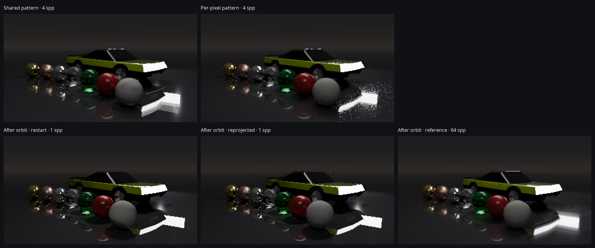

| Mode | s / spp | RMS @1 | RMS @16 | Digest @16 | Verdict |
|---|---|---|---|---|---|
| Shared pattern, traced (default) | 0.407 | 0.347 | 0.0359 | `b12c0517` | Bit-identical to before (`2dc6f6ca` determinism, `a0ca494d` smoke) |
| Per-pixel pattern | 0.469 (+15 %) | 0.364 | 0.0383 | `762d9b16` | Same error, banding → grain; slower (SIMD divergence) |
| Shared, rasterized visibility | 0.428 (+5 %) | 0.347 | 0.0359 | `016d3087` | **No gain**: camera rays are ~1 of 8.5 rays and already coherent |

Raster vs traced at 16 spp: 28 of 14,400 pixels differ, relative RMS 1.2e-4 (sliver triangles under subpixel
snapping, coplanar ties). 🔍 A 3×3 neighbourhood re-test was tried and made it worse (17 vs 14 pixels at 320×180).

| After orbit, spp | 1 | 2 | 4 | 8 | 16 |
|---|---|---|---|---|---|
| Restart (default) | 0.358 | 0.157 | 0.080 | 0.054 | 0.030 |
| Reprojected, capacity by base roughness (v1) | 0.330 | 0.285 | 0.236 | 0.154 | 0.043 |
| Reprojected, coat-aware, mirrors keep none (kept) | **0.263** | 0.157 | 0.095 | 0.068 | 0.043 |

| Displayed 320×180 frame after orbit (8-bit vs 64 spp) | Mean abs. levels | Pixels off > 8 levels |
|---|---|---|
| Restart, 1 spp | 5.63 | 16.2 % |
| Reprojected v1, 1 spp | 4.59 | 10.5 % (but smeared floor reflection) |
| Reprojected v2, 1 spp | 5.27 | 14.3 % |

- Reprojection pass: 24 ms at 160×90 (≈ 6 % of one sample); 40 % of pixels keep history (v1: 84 %).
- 🚩 v1 carried the epoxy floor's mirror reflection by surface position, so it lagged and slowed convergence 2–4×.
  v2 fixes that by giving mirror-like lobes no history; the floor then shows raw 1-spp structure.
- From 4 spp on, v2 history still cost accuracy (0.043 vs 0.030 at 16). Fixed in v3, see
  [Denoiser and temporal reuse](#denoiser-and-temporal-reuse) (the tables above are the v1/v2 runs).

## Sample patterns: shared, per-pixel, blue-noise

Phase `patterns` (Hero, 160×90, reference = shared at 1024 spp). "Blurred" applies a σ = 1 px Gaussian to image and
reference: a proxy for viewing, since the eye averages fine dither but not bands or clumps.

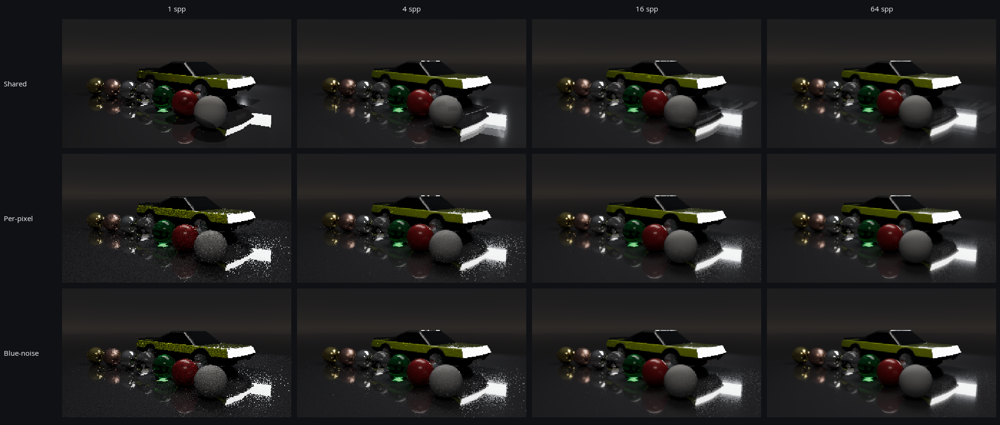

| Blurred RMS (perceived) | 1 | 2 | 4 | 8 | 16 | 32 | 64 |
|---|---|---|---|---|---|---|---|
| Shared | 0.172 | 0.080 | 0.042 | 0.020 | 0.015 | 0.011 | 0.0053 |
| Per-pixel | 0.174 | 0.060 | 0.026 | 0.020 | 0.012 | 0.008 | 0.0043 |
| **Blue-noise** | **0.169** | **0.057** | **0.023** | **0.019** | **0.011** | **0.008** | **0.0041** |

| Plain RMS | 1 | 4 | 16 | 64 | s / spp | Digest @64 |
|---|---|---|---|---|---|---|
| Shared | 0.347 | 0.082 | 0.036 | 0.0151 | 0.391 | `81a50a32` |
| Per-pixel | 0.364 | 0.083 | 0.038 | 0.0149 | 0.447 (+14 %) | `260dfe67` |
| Blue-noise | 0.360 | 0.079 | 0.037 | 0.0146 | 0.454 (+16 %) | `d3fbac0b` |

- Same plain error for all three (same estimator, same convergence). Only where the error sits on screen changes.
- Blue-noise is deterministic: `d3fbac0b` from batch 1 (phase run), batch 8 and batch 64 (fresh browser).
- The cost is divergence between neighbouring pixels, not the table: one lookup per pixel instead of per pair was
  no faster (+24 % vs +21 % at 320×180, 4 spp).
- 🔍 Bright, small features (the floor's softbox reflection) still sparkle at ≤ 16 spp in both dithered modes.

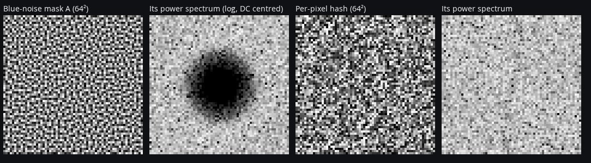

Mask check (`Results/BlueNoiseMask.json`): power in frequency bands 1–4 is 3.2e-6 for the blue-noise mask vs 6.4e-2
for the per-pixel hash; bands 24–31: 0.115 vs 0.079. Masks A and B correlate at 0.02.

## Denoiser and temporal reuse

Phase `reconstruction` (Hero, 160×90, errors vs exact 256 spp; display error = 8-bit ACES/sRGB levels).
`DisplayReconstruction.wgsl` reads the exact sums and writes only a display buffer, so sums, digests and
convergence are unchanged (smoke digest still `a0ca494d`). No RNG anywhere: weights are fixed functions of the
sums and a guide buffer (centre-ray position, normal, material, roughness).

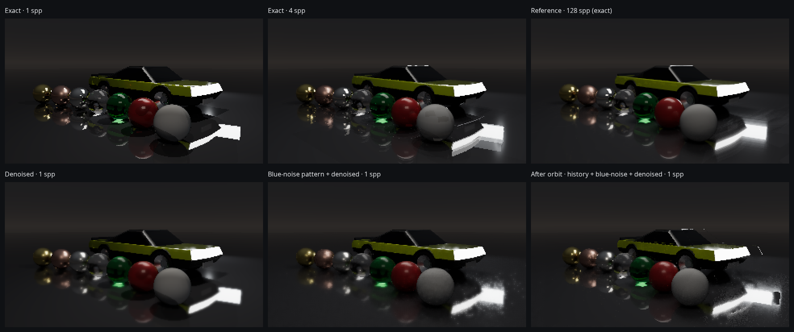

| Still frame | RMS @1 | Levels @1 | RMS @2 | Levels @2 | RMS @4 | Levels @4 | RMS @8 | Levels @8 |
|---|---|---|---|---|---|---|---|---|
| Shared, exact | 0.347 | 6.29 | 0.159 | 5.04 | 0.082 | 3.18 | 0.056 | 2.12 |
| Shared, denoised | **0.222** | 5.03 | 0.125 | 4.44 | 0.081 | 3.08 | 0.055 | 2.10 |
| Blue-noise, exact | 0.359 | 7.06 | 0.160 | 4.52 | 0.079 | 3.23 | 0.058 | 2.33 |
| Blue-noise, denoised | 0.234 | **4.06** | **0.112** | **2.84** | **0.074** | **2.54** | 0.057 | 2.16 |

- Blue-noise + denoiser at 1 spp has lower display error (4.06) than exact shared at 2 spp (5.04); at 2 spp
  (2.84) it beats exact at 4 spp (3.18). The 64 spp image equals the exact one (strength 0).
- Shared pattern gains less: every pixel uses the same point set, so neighbours share the same error and
  averaging them cannot remove it. Decorrelated (blue-noise) error is what a spatial filter removes.
- 🔍 First version (fixed σ = 4) was worse than exact from 4 spp (RMS 0.124 vs 0.082): it smeared highlights.
  A sweep (σ 1/2/4 × 1–8 spp) showed the best σ halves per doubling, so σ is now 4/n.
- Determinism: denoised display after 4 spp, batch 1 vs batch 4: `c153d6c4` = `c153d6c4`.
- Cost: 58 ms per reconstruction at 160×90 = 0.15 of one sample (SwiftShader, run once per displayed frame).

| After orbit (0.05 rad from 32 spp), RMS / levels | 1 spp | 2 spp | 4 spp | 8 spp | 16 spp |
|---|---|---|---|---|---|
| Restart | 0.358 / 6.59 | 0.157 / 5.31 | 0.080 / 3.33 | 0.054 / 2.18 | 0.030 / 1.71 |
| v2 history (previous run, RMS only) | 0.263 | 0.157 | 0.095 | 0.068 | 0.043 |
| v3 history, span 16 | 0.235 / 4.75 | 0.138 / 3.98 | 0.094 / 3.12 | 0.059 / 2.19 | 0.030 / 1.71 |
| **v3 history, span 8 (default)** | 0.235 / 4.74 | 0.137 / 3.96 | 0.084 / 3.02 | 0.054 / 2.18 | 0.030 / 1.71 |
| v3 span 8 + clamp γ 1.5 | 0.233 / 4.93 | 0.136 / 4.27 | 0.082 / 2.90 | 0.054 / 2.18 | 0.030 / 1.71 |
| Restart + denoised | 0.241 / 5.19 | 0.134 / 4.64 | 0.083 / 3.23 | 0.054 / 2.16 | 0.030 / 1.72 |
| v3 history + denoised | **0.208** / 4.00 | 0.133 / 3.72 | 0.090 / 3.03 | 0.054 / 2.16 | 0.030 / 1.72 |
| v3 history + denoised + blue-noise | 0.215 / **3.82** | **0.126** / **3.09** | 0.086 / **2.55** | 0.056 / 2.22 | 0.031 / 1.71 |

- v3 = reflections get their own motion and history fades by (1 − n/span)². Mirror-like surfaces (coated
  floor) are reprojected through the reflected object's virtual image (hit distance + mirror-ray length) and
  accepted only if the previous pixel reflects the same object. 1 spp RMS: v2 0.263 → v3 0.235.
- Drag fixed: span 8 equals restart from 8 spp on (v2: 0.068 vs 0.054 at 8, 0.043 vs 0.030 at 16).
- The neighbourhood clamp is kept as an option (`clamp=`) but off: with the shared pattern the 1 spp
  neighbourhood carries the same structured error, so clamping pulls history towards it (levels 4.74 → 4.93).

⚠️ Not yet a clean 1 spp frame. Remaining artefacts (visible above): dither on the mirror floor, where only the
two finest filter steps apply to keep reflection detail (🔍 allowing 4 steps there was worse at every count:
blue-noise 1 spp 4.06 → 4.28 levels, 4 spp 2.54 → 2.84); scattered bright pixels around the softbox reflection
after an orbit; the denoised shared-pattern frame keeps the low-spp shapes (blotchy reflections) of the exact one.

## Vehicle count (FPS impact)

Phase `fleet` (320×180, one sample per dispatch as the interactive loop runs, 1 warm-up + 4 timed samples). Extra
vehicles are **instances** of the one ControlVehicle in a parking grid (`vehicles=N`): 5 rows × 10 bays, row pitch
9.7 m, bay pitch 3.6 m for a 6.22 m × 2.50 m body, so the closest two cars are 1.10 m apart. Alternate rows face
each other. One 4-wide vehicle tree is shared by all bays; a 4-wide instance tree (one bay per leaf) sits on top.

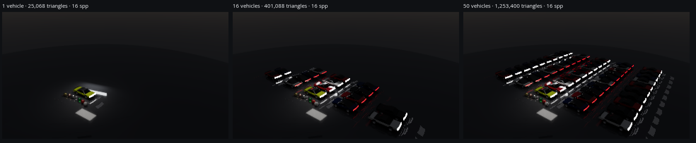

| Vehicles | Triangles | Tree nodes (vehicle + instance) | Depth | Tree build (JS) | Hero s/spp | Fleet s/spp | Hero cost | Fleet cost | Fleet rays / box tests / triangle tests per pixel-sample |
|---|---|---|---|---|---|---|---|---|---|
| 1 | 25,068 | 3,895 + 1 | 12 | 0.169 s (vehicle tree, once) | 1.82 | 0.75 | 1.00× | 1.00× | 4.95 / 10.5 / 0.9 |
| 2 | 50,136 | 3,895 + 1 | 12 | 0.001 s | 2.23 | 0.78 | 1.22× | 1.04× | 4.99 / 18.6 / 1.4 |
| 4 | 100,272 | 3,895 + 1 | 12 | 0.001 s | 2.58 | 0.96 | 1.42× | 1.28× | 5.10 / 37.5 / 2.9 |
| 8 | 200,544 | 3,895 + 4 | 13 | 0.001 s | 3.00 | 1.11 | 1.64× | 1.49× | 5.23 / 51.3 / 4.8 |
| 16 | 401,088 | 3,895 + 7 | 14 | 0.002 s | 3.33 | 1.46 | 1.83× | 1.96× | 5.53 / 82.2 / 9.1 |
| 32 | 802,176 | 3,895 + 15 | 14 | 0.001 s | 3.53 | 1.92 | 1.94× | 2.58× | 5.90 / 123.3 / 14.3 |
| 50 | **1,253,400** | 3,895 + 25 | 15 | 0.002 s | 3.56 | 2.40 | 1.95× | 3.22× | 6.14 / 150.5 / 17.6 |

- **Instancing:** the GPU tree is 257 KB at 50 vehicles (baked: 799,599 entries ≈ 25.6 MB, plus 120 MB of
  copied triangles). Changing the count takes ≈ 1 ms instead of 5.36 s, so vehicles could move per frame.
- 50× the triangles costs 1.95× (Hero) to 3.22× (Fleet, whole lot on screen; baked tree: 3.37×) per sample.
- **Bit-exactness:** one vehicle renders bit-identical to the old binary tree (`a0ca494d`, 320×180, 16 spp, and
  equal Hero/Rear digests at 160×90). Fleets now use object-space rays, so their digests changed once; each
  repeats exactly (50 vehicles: batch 1 = batch 4, `3237779d`).
- ⚠️ **SwiftShader penalty.** Same-run A/B against the binary baked tree (160×90, 4 spp, min of 2):
  1 vehicle 550 vs 434 ms/spp (Hero), 457 vs 360 (Rear); 50 vehicles 940 vs 784, 933 vs 789: ≈ 1.2× slower.
  The work is the same (Hero 1 car: 8.3 rays, 11 triangle tests, 81 vs 75 box tests per pixel-sample), but
  SwiftShader inlines every call and keeps the whole tree in CPU cache: it charges for shader size and gives
  nothing for smaller nodes. Removing all traversal code made even the vehicle-free scene 1.24× faster than
  the old build, and folding both tree levels into one loop per query cut the penalty from 2.3× to 1.2×.
  Real GPUs are usually limited by memory latency in traversal, where 4-wide 64-byte nodes and a ≈ 50× smaller
  fleet footprint (2.7 MB vs 145 MB) are the usual win. That is **not measured here**; the inspector's GPU-per-frame row is the
  way to check it on hardware.
- FPS at one sample per frame is 1 / (s/spp). SwiftShader seconds are not GPU timings.

### 🐞 Bias found and fixed by claim 3

| | Before | After |
|---|---|---|
| `FresnelSchlick` | F90 = 1 | F90 = saturate(50·F0) |
| RMS @ 1024 spp | 3.8e-3 (plateau) | 3.4e-4 (still falling) |
| Worst pixel | 4.6 % (grazing rows) | 0.10 % |

With F90 = 1 a material with F0 = 0 (the Lambert reference) still reflected at grazing angles and lost
diffuse energy. Clamping F90 by F0 is the standard fix; F0 ≥ 0.02 materials are unaffected.

## Reproduce

```sh
cd Exhibits/DeterministicPathTracer/Code
npm install                      # puppeteer-core + @sparticuz/chromium (unpacked to ChromiumRuntime/)
node RunValidation.mjs all       # or: quadrature | analytic | determinism | convergence | chart | captures | interface | realtime | patterns | fleet | reconstruction
ANALYTIC_SAMPLES=256 node RunValidation.mjs analytic   # shorter analytic run
```

`all` takes about 70 min on 2 CPU cores (SwiftShader; `realtime` ≈ 8 min, `patterns` ≈ 13 min, `fleet` ≈ 3.5 min,
`reconstruction` ≈ 11 min). Writes `Results/` and `Images/`.

## Environment

| Item | Value |
|---|---|
| Revision | branch `arena/7afbeba9-frontier` from `96f31ec`, uncommitted working tree |
| Browser | headless Chromium from `@sparticuz/chromium`, `--enable-unsafe-webgpu` |
| WebGPU adapter | **SwiftShader** (CPU), 2 cores — no physical GPU |
| Hero cost | 0.26 s per spp at 160×90 on SwiftShader (not a GPU timing) |

## Limitations

- ⚠️ **No GTX or RTX run.** Portability rests on design (plain compute shader, software bounds tree, no
  ray-tracing extension, 8 storage buffers), not on a measurement. No GPU performance claim.
- Bit-exactness is shown for one device/driver. WGSL leaves transcendental precision to the implementation,
  so two GPUs need not match each other; each should repeat itself exactly (re-run `determinism` there).
- Claim 3 covers direct lighting from one rectangular light on a diffuse floor. Glossy, coat, conductor,
  glass and multi-bounce transport are checked only by self-convergence (claim 5) and visual inspection.
- The interface capture uses the readback display. The default WebGPU-canvas display could not be exercised:
  this SwiftShader build has no shared-image backing for a WebGPU swap chain and loses the device on the
  first present. Capturing it also exposed a real CSS bug (the hidden failure notice was drawn as a 92 %
  dark veil over the viewport); fixed in `Styles.css`.
- Deterministic is not instant: low spp shows structured artefacts instead of grain.
- The bright rectangle on the floor at the lower right of Hero is the rim softbox mirrored in the coated
  epoxy (gone on matte Concrete, unchanged with spheres removed); correct, not an artefact.
