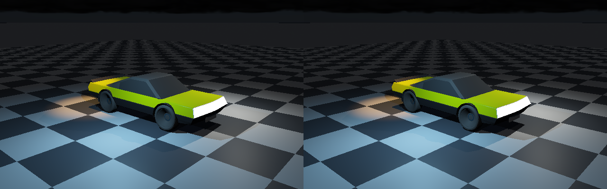

# Vulkan analytic-light computation

**Actual Vulkan execution, not a CPU mock of a compute dispatch.** Shared Slang builds light cells, evaluates
point/spot/LM-63 profiles and GGX, traces triangle-BVH shadow rays, and performs fresh RIS on the ControlVehicle.
The tested Vulkan device is **SwiftShader Device (Subzero), CPU device type 4**, API 1.3.0, Slang 2026.14.1.
No physical GPU or RTX execution is claimed.



**Left:** native double-precision exact lighting. **Right:** Vulkan float32 clustered exact lighting.
Both use the same CPU-rasterized primary surfaces and CPU sky/indirect background. Vulkan recomputes direct
illumination and shadow visibility; it does not copy the native direct-light answer. Only the native surface
inputs and residual sky/indirect/emissive contribution are supplied. The uploaded `ExpectedDirect` channel is deliberately poisoned with NaNs; it must not influence shader
output. Unpoisoned native answers remain solely in host memory for independent comparison.

## Executed sequence

```text
Original ControlVehicle + authored materials
    → native primary visibility + surface inputs + residual sky/indirect/emissive RGB
    → upload float32 lights, receivers, LM-63 tables, full-scene triangle enclosures
    → Slang AssignLightCells                       [Vulkan compute]
    → shader-write / shader-read memory dependency
    → Slang EvaluateLightReceivers                 [Vulkan compute]
         exact sum OR fresh RIS → triangle-BVH shadows → linear RGB
    → shader-write / host-read memory dependency + fence
    → actual mapped-buffer readback → native display encoding → PNG
```

The dispatch has eight storage buffers, an 80-byte push constant, persistent pipelines/descriptors, explicit
host-coherent allocations and a completed fence before readback. There is no optional device-feature dependency.
Headers, compiler, software driver and compiled shader hashes are recorded; downloads/binaries remain ignored.
Compilation uses direct SPIR-V at `-O0` because the pinned wheel does not include downstream SPIR-V optimizers.
This is an execution/correctness configuration, not a tuned performance result.

## Results

| Check | Observed result |
|---|---|
| Real vehicle | 25,068 original vehicle facets; 28,276 full-scene facets; 640×400 receivers |
| Uploaded native-answer channel | Poisoned with NaNs; finite matching shader output retained |
| Vulkan all-light versus clustered | Float32 readback buffers **exactly identical** |
| Forced one-light cell capacity | Identical output through all-light fallback |
| Candidate-list visits | 8,107,704 → 2,682,703, **66.91% fewer**; no timing/speedup claim |
| Outside-grid/overflow queries | 56,643 fallback queries in the vehicle clustered run |
| Shader triangle visibility | 513,697 BVH shadow queries; no normal-stack overflow |
| Vulkan versus native linear RGB | Mean absolute error 2.02268e-6; max 6.44028e-5; no channel above 1e-3 |
| Display comparison | 183 of 256,000 pixels differ, by at most **one 8-bit code step** |
| Dense synthetic cells | 97 simultaneous lights retained; all 512 receivers use exhaustive fallback |
| Synthetic profiles/GGX versus native | Maximum absolute RGB error 8.58307e-6 |
| Fresh GPU RIS, 256 seeds | Mean luminance sum 1482.31; native exact 1480.88; standard error 0.694124 |
| Forced enclosure-stack limit of one | 49,664 exhaustive triangle fallbacks; matches ordinary BVH output |
| Offscreen caster | Ten caster facets fully shadow synthetic receivers; no primary-frustum dependency |
| Native regression | CTest 4/4, recovered checks 188/188, focused ASan/UBSan clean |
| Prior vehicle/distance images | All six rerendered, byte-identical to the preceding checkpoint |

The sampling comparison is statistically consistent for this fixture, not a general proof of unbiased reuse.
The first vehicle RIS seed has luminance sum 60714.5 versus exact 60723.4. This is **fresh, unfiltered sampling**;
individual pixels remain noisy. The diagnostic image is `Images/FreshRis.png`, not finished image-quality sign-off.

## Correctness and limits

- Shader cell storage has a configurable capacity. Above capacity, or outside the grid, evaluation enumerates
  all global light IDs. No excess assignment is silently discarded. Float32 sphere/box tests include roundoff padding.
- The shader grid/evaluation is reusable; the validation host fixes an 8×8×4 grid and supports capacity 1–16.
- `TriangleVisibilitySpace::PackFloat32` retains all scene facets, orders leaf ranges and expands converted bounds
  outward by one float32 step. No primary-frustum culling is applied. A bounded shader stack falls back to a
  whole-scene triangle scan if exhausted; the forced-limit test exercises that path.
- LM-63 angles and relative-peak candela tables are uploaded explicitly, with the native angular symmetry rules.
  Profiles remain the supported Type-C/TILT=NONE subset. The committed file is synthetic, not manufacturer data;
  absolute lumen calibration is not supplied. Relative normalization avoids candela magnitude overflow on upload.
- Native surface export is opt-in and rejects filtering, fog, multiple accumulation frames and non-exhaustive
  direct lighting. Its sample layout is exercised by `LightValidation`; export leaves rendered pixels unchanged.
- The private versioned `.bin` under ignored scratch storage is a diagnostic GPU-buffer interchange, not an
  engine-authored content/configuration format. Runtime authoring remains TOML. No new persistent scene format
  is introduced and no large binary capture or dependency is committed.
- Host library loading is explicit. Missing features/limits, Vulkan errors, shader files, archives and numerical
  mismatches fail the executable rather than producing a success image. Khronos validation layers were not run.

## Reproduce on Linux x86-64

Requires C++17, CMake 3.20+, Node and Python 3.9+. The dependency script verifies fixed SHA-256 digests and writes
only under ignored `ExternalPackages/VulkanCompute`. It does not install system packages or dispatch Actions.

```bash
PREPARE=1 bash Exhibits/LightCompute/Run.sh
# Once dependencies are restored:
bash Exhibits/LightCompute/Run.sh
```

For another Vulkan implementation, supply `VULKAN_LIBRARY=/absolute/path/to/libvulkan.so.1` and configure its ICD.
`SLANGC` may name an existing compatible compiler. CPU versus hardware device identity is printed at runtime;
supplying a hardware driver does not by itself establish a tested GTX/RTX result. The host currently selects
its first compute-capable device, reports ray-query extension presence, and executes only shader triangle-BVH
visibility. It does not enable acceleration structures or hardware ray queries.

Windows entry: `Run.ps1`, using a Vulkan SDK/header installation, compatible `slangc`, Node, Python, CMake and
MSVC. `SLANGC`/`VULKAN_LIBRARY` override the compiler/loader. **This entry point is supplied, not executed here**;
no Windows binary or device result is claimed. The Linux dependency restore is intentionally platform-specific.

## Integration boundary

This is shared Slang lighting executed through a native Vulkan validation submission, not the production editor
viewport or a complete GPU renderer. Primary raster, sky/indirect transport, temporal reprojection, spatial reuse
and filtering have not moved to GPU here. RTX acceleration-structure/ray-query execution and physical GTX/RTX,
Windows and moving-history acceptance remain separate work. The next phase should connect GPU reservoirs,
reprojection/disocclusion rejection and variance filtering against these exact references; avoid replacing
numerical comparison with visual resemblance alone.
