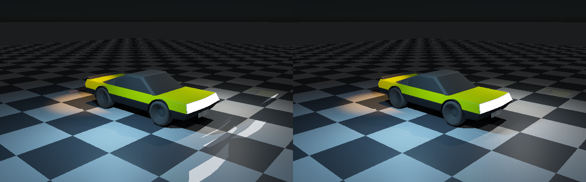
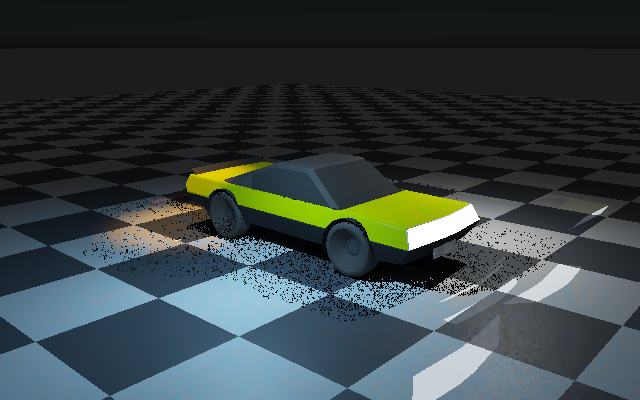
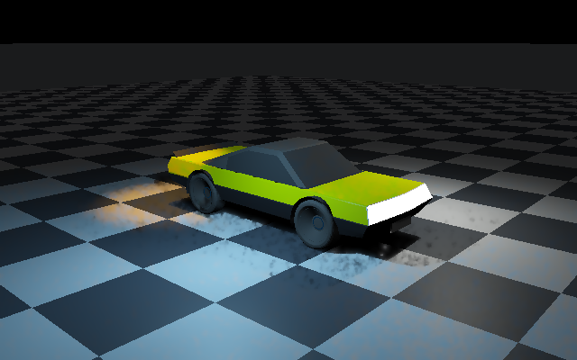

# Vulkan primary visibility, light history and reconstruction

**Actual Vulkan execution:** shared Slang now performs clustered analytic lighting, temporal/spatial reservoir
reuse, reprojection rejection, temporal moments and edge-aware reconstruction on the original ControlVehicle.
The tested device is **SwiftShader Device (Subzero), CPU type 4**, Vulkan 1.3.0, Slang 2026.14.1.
No physical GPU, hardware ray-query or Windows execution is claimed.

## Emissive triangle importance sampling — executed




The secondary-emission part of the diffuse integral now has a dedicated estimator. A CPU geometry pass builds
a cumulative distribution over **1,130 positive-area emissive triangles**, weighted by world-space area times
RGB luminance. Vulkan selects a triangle, samples its area uniformly, traces a full-BVH visibility segment,
and evaluates the diffuse response with the triangle probability, area, inverse-square distance and receiver/
emitter cosine factors. Emission is two-sided to match the existing face-forward surface interpretation.
Primary visible emission remains separate and unchanged.

The hemisphere route still evaluates analytic point/IES/spot/directional lighting at secondary hits and the
atmosphere cube on misses. When explicit emitter sampling is enabled, secondary emission is omitted from the
hemisphere route, so it is not accumulated twice. This is a **partition of lighting contributions**, not MIS,
not a removal of analytic lights, and not resolution of authored analytic-proxy/emissive energy accounting.
A cumulative table is sufficient for this fixture; no new emissive spatial clustering is required or claimed.

| Verified check | Observed result |
|---|---|
| Samples | 16 hemisphere directions plus 16 area-emission draws per receiver |
| Independent native same-draw probes | 225 distributed surface receivers; mean RGB error 7.2128e-9; max 1.36771e-6 |
| Higher-sample native reference | Independent seed 8171, 8,192 area draws per probe |
| Old hemisphere emission RMSE versus that reference | 0.206886 |
| New area-emission RMSE versus that reference | 0.00906289: **95.62% lower** |
| Six moving poses | Current indirect/emission equals fresh evaluation bitwise at every pixel |
| Moving direct history | Valid acceptance survives CDF rebuilds; light change at pose 3 resets it |
| Empty emitter set | Bitwise equal to the hemisphere route with emission absent |
| Disabled environment | Exactly matches zero-environment evaluation; no cube metadata leaks into misses |
| Invalid zero probability | Rejected on CPU before Vulkan dispatch |
| ASan/UBSan | New estimator, native reference and safety checks passed; external-driver leak detection off |

This error reduction is **probe-only, one fixture and seed 71**, not a full-image quality statistic, universal
unbiasedness proof or equal-cost speedup. The higher-sample reference is itself a finite Monte Carlo estimate.
Explicit area samples add visibility work on top of the retained hemisphere routes. The comparison deliberately
isolates transported emission from analytic and environment lighting, and excludes primary visible emission.
Native area integration independently evaluates geometry, barycentric points, diffuse response and shadow BVH;
it shares the uploaded probability table and random integer sequence to check matching GPU draws.

The float CDF reserves one of 2²⁴ probability ticks for every positive-area emitter, then distributes the
remaining ticks by emitted power. Thus dim triangles retain nonzero probability rather than silently vanishing
through float rounding. Every entry's facet bounds, positive area/PDF, CDF monotonicity and normalization are
checked before dispatch. The profile buffer reserves enough span for moving CDFs. Direct-light revision checks
compare the exact light/profile/environment prefix, excluding the appended geometry-dependent emissive CDF;
per-pixel direct surface compatibility and current indirect evaluation remain active.

**Visual result:** the displaced bright illumination footprints are substantially removed; residual sampling
grain remains. This phase does **not** add indirect temporal accumulation or denoising, glossy transport,
GPU atmosphere/clouds or Moon rendering. Native Sun/flare/stars remain untouched. The executed device is still
**SwiftShader CPU type 4**, not physical RTX/GTX or Windows acceptance.

Focused reproduction (about a long software-rendering test run, not interactive frame timing):

```bash
# Set PREPARE=1 on a machine needing the pinned ignored Vulkan tools.
bash Exhibits/LightCompute/RunEmissive.sh
```

The full `Run.sh` now includes these checks after prior regressions. `Run.ps1` includes corresponding commands
but was not executed on Windows. `Results/EmissiveArea.txt` preserves the final sanitizer-executed numeric and
safety checks; `EmissiveRegression.txt` retains the rerun exact/cluster/reservoir/history regression, and
`EmissiveSanitizers.txt` identifies the sanitizer configuration. Original cosine transport and primary native
checks were also rerun. The ignored `EmissiveScene.bin`, including its CDF, is hashed in the manifest.

## One-bounce diffuse transport and atmosphere cube — executed




`TraceSurfaceTransport` now follows the camera-surface pass, before direct lighting and reconstruction. It traces
16 cosine-weighted hemisphere directions through the **full-scene triangle BVH**, including offscreen geometry.
A secondary hit contributes its authored material emission plus exact analytic point/IES/spot/directional light
arrival, native-equivalent GGX BRDF and shadow visibility. A miss samples the atmospheric radiance cube.
The primary vertex applies a Fresnel-weighted **diffuse** response; glossy indirect reflection is not included.
Direct GGX lighting is unchanged. Neither analytic lights nor emissive geometry was removed.

The environment cube has six 48×48 RGB float faces, baked by native `SingleScattering` and its transmittance LUT
at the fixture's 4 m observer altitude. Sun direction and irradiance come from the existing directional light.
Vulkan performs bilinear cube lookup for camera misses and unoccluded secondary rays. This is **CPU atmospheric
precomputation consumed by GPU transport**, not per-pixel CPU radiance or a GPU atmosphere/cloud implementation.
Existing Sun/flare/star rendering code remains untouched; the cube itself does not add those presentation effects.

| Verified check | Observed result |
|---|---|
| Secondary rays, 640×400 | 3,603,424: 263,475 triangle hits; 3,339,949 environment misses |
| Independent native transport probes | 901 distributed surface receivers × 16 directions |
| Probe mean / maximum RGB error | 2.08237e-8 / 4.6271e-6 |
| Analytic-only indirect RGB sum | 2053.27 |
| Emissive-only indirect RGB sum | 19571.8, excluding primary visible emission |
| Environment-only diffuse RGB sum | 612.624 |
| Sum of isolated routes versus combined transport | Maximum RGB discrepancy 8.44442e-6 |
| All light families and environment disabled | Exactly black |
| Six moving poses | Current indirect/emission equals fresh evaluation bitwise at every pixel |
| Light revision, moving pose 3 | Zero accepted direct-light histories |
| ASan/UBSan transport execution | Passed; external-driver leak detection disabled |

The probe oracle uses a rebuilt double BVH, independently computed hit barycentrics, native light arrival,
public IES profile import, native secondary BRDF/shadows and an independently evaluated diffuse primary response.
It checks the same finite quadrature, **not convergence to a high-sample path-traced reference**. The source-isolation
sum detects accidental duplicate accumulation in this integrator; it does not resolve whether an authored
analytic proxy duplicates the physical energy of an emissive fixture. Proxy/source accounting remains open.

Only direct-light reservoirs/colour history are reconstructed. Indirect and visible emission are freshly
computed each frame and added afterward, so old screen-space radiance cannot survive a source or pose change.
The moving checks use one history update per pose, without the earlier 16-update warmup. Their errors versus
exact direct lighting with the **same finite indirect quadrature** are retained in `Results/TransportMotion.txt`;
those are not measurements of total indirect-lighting accuracy.

**Visible limitation:** 16 fixed hemisphere directions produce coarse displaced illumination footprints around
bright emitters. They are quadrature artifacts, not validated glossy reflections. The new indirect contribution
is not temporally accumulated or spatially denoised. Multi-bounce transport, emissive importance sampling,
glossy transport, seamless/high-resolution atmosphere evaluation and sky/cloud appearance are still open.
This capture establishes the executed transport path, not final renderer quality or a performance win.

The shared shader now has **eight compute entries**, eight SSBOs and the unchanged 128-byte push ABI. The native
cube adds 165,888 bytes and hemisphere directions add 192 bytes to the profile/sample buffer; no per-pixel CPU
residual is uploaded. Private camera metadata stores their offsets. `TransportScene.bin` is retained only in
ignored scratch storage and hashed in the evidence manifest; it is not a new public scene format.

Reproduce all regressions and transport/motion checks with `bash Exhibits/LightCompute/Run.sh`.
The focused command after build/export is:

```bash
VK_ICD_FILENAMES="$PWD/ExternalPackages/VulkanCompute/SwiftShader/vk_swiftshader_icd.json" \
_ClaudeScratch/build/light-compute/LightComputeValidation \
  "$PWD/ExternalPackages/VulkanCompute/SwiftShader/libvulkan.so.1" \
  "$PWD/_ClaudeScratch/build/light-compute" \
  _ClaudeScratch/vehicle-primary/VehiclePrimary.bin _ClaudeScratch/light-compute --transport-only
```

Sanitizer reproduction uses the same command with `ASAN_OPTIONS=detect_leaks=0` and the executable configured
by CMake under `_ClaudeScratch/build/transport-sanitizers` with `-fsanitize=address,undefined` in compile/link
flags. `Results/TransportSanitizers.txt` preserves the executed checks. No physical GPU, RTX query, Windows
runtime or production viewport acceptance is claimed. Moon remains in `Documentation/EnvironmentTodo.md`.

## Moving Vulkan-primary reconstruction — executed




`VehicleCapture --primary-motion` exports six rigid/camera poses **without native rasterization**. Every exact,
fresh and history dispatch regenerates camera hits, surfaces, material emission and motion metadata on Vulkan,
after poisoning all receiver channels. The persistent history receives 16 static updates and then five moving
updates. Analytic light colour changes at pose 3 force a complete history reset. These captures use a black
environment and visible material emission—not indirect transport or emissive-source sampling.

| Pose | Fresh RGB RMSE | Reconstructed RGB RMSE | Accepted / rejected receivers |
|---|---|---|---|
| 0, after 16 updates | 0.134862 | 0.041186 | 225214 / 0 |
| 1 | 0.133991 | 0.0513191 | 152325 / 72955 |
| 2 | 0.131754 | 0.057873 | 152590 / 73330 |
| 3, light revision | 0.130677 | 0.0920956 | 0 / 225973 |
| 4 | 0.129381 | 0.0425442 | 153020 / 73540 |
| 5 | 0.126105 | 0.042405 | 153177 / 73558 |

Use `Results/PrimaryMotion.txt` for authoritative rounded measurements. Across moving poses, RMSE sums are
0.651907 fresh versus 0.286237 reconstructed: **56.09% lower**, a fixture-quality result, not an equal-cost speedup.
The lossless six-frame APNG has illustrative timing, not measured frame times. `PrimaryMotionReject1.png`
shows accepted colour in green, sampled visibility rejection in orange, rejected history in red, misses black.

Independent native first-hit/shading checks execute at every pose, on a separate Vulkan submission so they cannot
consume the history context's light-revision reset. A native rigid-transform/projector also checks every generated
surface's previous world position, normal, pixel and projection validity. Maximum observed reprojection error is
0.00012207 pixels, world error 4.76837e-7 m, normal-component error 1.19209e-7. The checks exposed inaccurate
shader sine/cosine evaluation on the software device; current/previous rotation coefficients are now computed
once per pose and uploaded, rather than recomputed approximately per pixel. Visibility remains shader-generated.

Camera-cut output matches a cold restart bitwise; disabling lights leaves no stale direct lighting; updating
facet emission matches exact current emission bitwise. All six poses have zero native/GPU hit/miss disagreement.
There are **11 triangle-identity differences** across the moving poses: six near triangle edges and five depth
orderings within `64 * float_epsilon * travel`. They remain counted, not described as identical geometry.
For matching facets, maximum relative depth error reaches 1.11028e-4 (bound 2e-4), and maximum RGB error is
6.93947e-5. Across **all** pixels, including edge/precision ambiguities, worst RGB error is 0.960438 and worst
relative depth error is 0.177935 at pose 2; per-frame mean RGB error remains at most 3.77025e-6.
These isolated visibility outliers are a robustness limitation, not hidden by the matched-facet statistics.
The oracle requires every interior identity mismatch to fit the stated float-depth tolerance; matched-facet
normals, full-image mean colour and all-pixel hit/miss checks remain independently gated.

Reproduce both retained regressions and moving-primary checks with `bash Exhibits/LightCompute/Run.sh`.
Windows command parity is in `Run.ps1`; Windows execution is **not** claimed. GPU indirect/environment transport,
RTX queries, physical-GPU performance and production viewport integration remain open. Existing environment
work and the planned Moon are retained, not replaced by this black-environment fixture.

## Primary camera rays — executed


`VehicleCapture --primary-input` skips both native renderer scene setup and rasterization. CPU work exports
mesh geometry, per-vertex normals, material records, lights and camera parameters only. Before dispatch, **all
36 floats of every receiver are poisoned with NaNs**. `TracePrimarySurfaces` generates pixel-centre camera rays,
traverses the full triangle BVH for the nearest clipped hit, interpolates normals/materials, and writes receivers.
Existing exact or clustered lighting then supplies direct illumination and BVH shadows. Material emission stays
independent of analytic point/IES/spot lights: neither lighting family was removed.

This controlled capture uses **a black environment, direct illumination and visible material emission**.
It does not upload a CPU per-pixel residual. It does not yet evaluate indirect transport or the native
sun/sky/cloud environment on Vulkan. The history images below retain their original CPU-primary environment path.

| Independent native ray check | Observed result |
|---|---|
| Camera coverage | 225,214 hits; 30,786 misses; zero hit/miss disagreement |
| First triangle | Zero identity disagreements on the vehicle scene |
| Maximum relative depth error | 5.00174e-6 |
| Maximum normal error, `abs(1-dot)` | 1.43991e-7, independently calculated barycentrics |
| Mean / maximum absolute RGB error | 2.03235e-6 / 6.93947e-5 |
| All-light versus clustered | Identical float32 output |
| Clipping fixture | Near/far rejection, nearest overlapping plane and all-miss case passed |
| Forced stack capacity one | 256 exhaustive fallbacks; same nearest depths and shaded output |

The oracle rebuilds a double-precision BVH from exported float vertices, independently computes camera rays and
barycentric weights, reconstructs Type-C profiles through the public IES importer, and evaluates the native BRDF,
light arrival and shadow queries. Forced traversal changes which triangle owns 16 exact shared-edge ties in the
16×16 fixture; these are individually classified as edge cases, not silently counted as identical facet IDs.
`Images/PrimaryNative.png` is the corresponding native ray result; `Results/Primary.txt` records all checks.

The private exhibit archive is now FLC3, with 144-byte shaded facets and camera metadata. Old scratch archives
must be regenerated. The shader still uses eight storage buffers; push constants are now **128 bytes** and
16 float4 output/history slabs occupy **65.536 MB** at 640×400, excluding receivers and scene geometry.
Primary generation writes rigid-motion metadata; its moving validation is documented above. The existing
six-pose CPU-primary history regression below was also rerun and passed.

## Retained history regression


Left is fresh eight-candidate RIS; right uses reservoir history and reconstruction at the **same moving pose**.
The sequence begins with 16 static updates. The vehicle then rotates/translates through five further poses while
the camera pans. A point-light colour change at index 3 deliberately resets all old light histories.


Animation timing is illustrative, **not measured rendering time or a dynamics simulation**. The six images are
actual Vulkan readbacks; no generated illustration or browser renderer is involved.

## Executed sequence

```text
Original ControlVehicle + authored materials
    → native primary visibility, stable surface tokens, rigid motion projection
    → current float32 surfaces + current full-scene BVH + current sky/indirect/emissive residual
    → AssignLightCells
    → EvaluateLightReceivers       fresh RIS + reprojected temporal reservoir + current visibility
    → ReuseLightNeighbours         compatible surface neighbours, target and visibility reevaluation
    → ReconstructLightHistory      temporal colour/moments, variance-based neighbourhood clipping
    → FilterLightNeighbours × 2    edge-aware à-trous filtering, steps 1 and 2
    → FinalizeLightHistory         current residual, persistent reservoirs/surface metadata
    → shader/host dependency + fence → actual readback → native display encoding → PNG/APNG
```

All eight computation entries are shared in `Frontier/Engine/Rendering/Shaders/LightInfluence.slang`. The host
retains pipelines/descriptors and uses eight storage buffers with a 128-byte push constant. Inter-dispatch,
inter-submission and host/readback dependencies are explicit. Prior metadata is never overwritten until all
reprojection and reconstruction reads have completed. Sixteen float4 surfaces occupy 65.536 MB at 640×400,
excluding receiver inputs and geometry; this is an unoptimized reference allocation, not measured GPU VRAM.

The uploaded native direct-answer channel is deliberately poisoned with NaNs. Unpoisoned native answers remain
only in host memory for numerical checks. The shader recomputes direct illumination and BVH shadow visibility;
primary raster, sky and indirect transport remain CPU inputs in this retained history regression only.

## Verified results

| Check | Observed result |
|---|---|
| Original vehicle | 25,068 vehicle facets; 28,276 full-scene facets; 640×400 receivers |
| Exact Vulkan all-light/clustered/forced-capacity routes | Identical float32 output buffers |
| Exact Vulkan versus native RGB | Mean absolute error 2.02268e-6; maximum 6.44028e-5 |
| Native/Vulkan display comparison | 183 pixels differ; maximum one 8-bit code step |
| Candidate-list visits in exact comparison | 8,107,704 → 2,682,703; 66.91% fewer, **not a speedup measurement** |
| Fresh RIS, 97 lights, 256 seeds | Mean luminance 1480.95; exact 1480.88; standard error 0.0842466 |
| Reuse: 64 independent chains × 4 updates | Mean 1480.78; exact 1480.88; standard error 0.123867 |
| Sixteen static updates | RGB RMSE 0.133629 → 0.0413195; **69.08% lower** |
| Five moving updates | Mean per-image RMSE 0.1303814 → 0.057318; **56.04% lower** |
| Moving index 1 | 152,328 accepted; 72,952 rejected; 1,212 sampled-visibility colour rejections |
| Moving light change, index 3 | Zero accepted histories; current light table used immediately |
| Changed material | Exactly 256 affected receivers rejected; 256 unchanged receivers accepted |
| Normal, invalid motion/camera cut, position mismatch | All 512 receivers rejected in each case |
| Camera-cut fallback | Exactly matches a cold restart with identical random seed |
| All lights off | History output exactly matches current exact image; no stale direct contribution |
| Residual refresh | Current exact image matched; no old residual accumulation |
| Triangle stack capacity forced to one | 49,664 exhaustive fallbacks; matches ordinary BVH visibility |
| Offscreen caster | Ten caster facets shadow synthetic receivers, independent of primary-frustum culling |

Errors compare the same current surfaces/lights/geometry. Static reconstruction has sixteen updates versus one
fresh image; the moving comparison uses the stated warmup and lighting reset. These are fixture-specific image
quality measurements, **not equal-cost performance comparisons**. Filtering/clipping is deliberately biased;
the unfiltered energy check is separate and does not certify arbitrary ReSTIR reuse as unbiased.

`Results/Vulkan.txt` has each moving pose's rejection counts, errors and native RGB comparison. `Results/History.json`
has the quality summary. `Images/MotionReject1.png` shows green accepted colour history, orange sampled-visibility
rejection, red rejected history and black uncovered pixels. The PNG animation is lossless and its frame payloads,
chunk sequence and checksums are independently checked by `Code/HistoryImages.py`.

## Mechanisms and limits

- Fresh proposals use receiver-dependent incoming irradiance power: range, angular profile and surface cosine,
  with a positive support floor. A permuted 32-bit congruential stream replaces plain LCG output. Native exact
  comparison, independent seeds and the separate unfiltered-reuse energy test validate this configuration.
- Overflow or outside-grid queries enumerate all global light IDs. No assignment is silently lost. The host
  uses an 8×8×4 grid and cell capacity 1–16; the shader preserves conservative float32 sphere/box padding.
- Reprojection checks stable surface token, previous world position and normal, roughness, albedo, metallic,
  index of refraction and specular level. Four projected neighbours are considered. The validation computes
  rigid motion and camera projection on CPU; deforming surfaces need appropriate motion inputs from their caller.
- Temporal/spatial reservoirs retain global light IDs. Targets and selected-light visibility are reevaluated
  against current geometry. A sampled visibility change rejects colour history. This is **not** a complete
  all-light visibility-change detector; difficult shadow/specular regions remain noisy and can exhibit filtering bias.
- Light/profile input bytes are compared exactly, not merely hashed. Changes reset history before sampling.
  Arbitrary topology/surface-token reassignment requires an explicit caller reset or submission recreation.
- Current sky/indirect/emissive residual is added after direct-light reconstruction every update. The refresh
  check demonstrates this path, **not** a GPU exitance-cache or multibounce transport implementation.
- Temporal moments use up to sixteen updates and neighbourhood variance clipping; two à-trous iterations reject
  incompatible material, normal and geometric neighbours. This is a reference reconstruction, not quality sign-off.
- `TriangleVisibilitySpace::PackFloat32` retains every facet and expands converted bounds outward. Bounded shader
  stacks fall back to exhaustive triangle scanning rather than dropping occluders.
- LM-63 remains the supported Type-C/TILT=NONE relative-peak subset. The fixture is synthetic, not manufacturer
  measurement or absolute lumen calibration. Existing emissive geometry remains present.
- Native surface export is opt-in and rejects filtering, fog, multiple accumulation updates and non-exact direct
  lighting. The private scratch `.bin` ABI is version 2 with 144-byte receivers. It is diagnostic buffer exchange,
  not a new persistent engine-authored content/configuration format; runtime authoring remains TOML.

## Reproduce

Requires C++17, CMake 3.20+, Node and Python 3.9+. On Linux x86-64:

```bash
PREPARE=1 bash Exhibits/LightCompute/Run.sh
# Subsequent runs:
bash Exhibits/LightCompute/Run.sh
```

The script builds all six Slang entries, renders one exact input plus six moving native inputs, then executes
numerical, sampling, rejection, history, motion and refresh tests. It may take several minutes on the software
device. Pinned downloads, executables, SPIR-V and large surface snapshots stay in ignored storage. Source,
compiled-shader, snapshot and product hashes are recorded in `Results/Manifest.json`.

Direct SPIR-V at `-O0` avoids downstream optimizers absent from the pinned wheel; no tuned performance is claimed.
For another driver use `VULKAN_LIBRARY` and its ICD configuration; `SLANGC` can name a compatible compiler.
Device identity is printed at runtime. The host selects its first compute-capable device, reports ray-query
extension presence, but does not enable hardware acceleration structures/ray queries. Missing limits or numerical
mismatches fail the run. Khronos validation layers were not executed.

`Run.ps1` supplies the Windows entry using MSVC, Vulkan SDK headers, compatible Slang, Node, Python and CMake.
It is supplied **but not executed here**; no Windows binary or GTX/RTX hardware result is claimed.

## Integration boundary

This executes shared shader lighting/history through a native Vulkan validation submission, not the production
editor viewport or a complete GPU renderer. Primary raster and sky/indirect transport remain CPU. Native rigid
motion is tested; deforming scenes, broader history/bias regressions, physical GTX/RTX, hardware ray queries,
Windows and interactive viewport acceptance remain open. Environment/Moon appearance requirements stay deferred.
