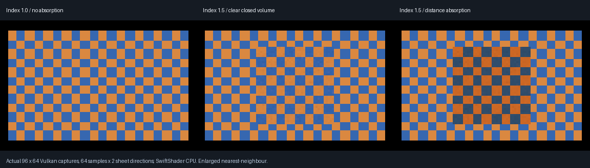

# Renderer progress — 2026-10-25

**Latest verified addition: primary thin-window rays followed by smooth closed glass.** All current
execution evidence is native C++ and **SwiftShader CPU Vulkan**, not physical RTX/GTX or the Windows editor.

**Legend:** 🟢 verified within the stated scope · 🚧 partial / still needs work · 🔴 blocked or not done.

## Done and remaining

| Status | Area | Done / evidence | Remaining |
|--------|------|-----------------|-----------|
| 🟢 | Analytic and emissive lighting | Both preserved; clustered analytic selection, visibility and temporal/spatial reservoir fixtures | Full engine/hardware acceptance; not a claim every emitter type is exhaustively covered |
| 🟢 | Original ControlVehicle material scene | Existing Racing Green cellular-flake coat, rubber, thin windows, BVH mirrors, cones and reused material previews captured in earlier checkpoints | New closed-volume bindings on the actual vehicle and saved material authoring |
| 🟢 | Primary smooth closed glass | Snell, exact Fresnel/TIR, radiance-index factors, distance absorption; four analytic slab cases | General arbitrary-mesh and scale acceptance |
| 🟢 | Mirror → closed glass | Four additional slab cases; actual behind-camera geometry seen through mirror; 6,144-pixel source-off black test | More mirror layouts, moving volume captures and general recursive mirror chains |
| 🟢 | Current pole-shadow fixture | 72 combinations, 3,538,944 silhouette comparisons, zero mismatches | Does not reproduce the user's old project defect |
| 🟢 | Rough reflection history fixture | Angular-aware reconstruction, 88 native filter probes; stale authored geometry history rejection; compact-only diffuse policy retained | Broader motion/noise/convergence coverage |
| 🟢 | Sun/flare/stars and selected cellular flakes | Existing implementations retained, not replaced by unrelated rewrites | Deferred sky/cloud appearance improvements below |
| 🟢 | Sampled rough reflection → smooth glass | Flat shared trace site; cosine/GGX proposals; absorption monotonicity, seeded repeat, screen/BVH equality and source-off checks | Legacy compact-only diffuse paths remain unsupported |
| 🟢 | Thin window → smooth glass | Four sheet/slab cases, two retained sheet-energy controls, source-off and pinned blocked-path control | Approximate sheet optics; no exhaustive multilayer/scale acceptance |
| 🚧 | Full glass/material system | Runtime coefficient override, bounded 32-interaction / 128-sample volume tracer | Saved TOML/preset/editor integration, rough glass, nested media, inside cameras, caustics and transmitted direct shadows |
| 🚧 | Reflection reconstruction / denoising | Limited authored rough-surface reconstruction and tested invalidation | Roughness-mip prior-screen colour/exitance, full denoiser and complete sampling/PDF/material acceptance |
| 🚧 | Clouds, fog and shafts | Earlier actual cloud/fog/geometry-shadow fixtures; lower-cost working cloud budget | Improve blocky clouds, horizon/sky, Milky Way/catalogues/extrasolar stars and dawn/sunset; moving full-scene acceptance |
| 🚧 | Bake / moving full scene | Earlier vehicle, triangle-BVH and distance-field-related exhibits exist | Unified ControlVehicle + baked distance field + sun/sky/cloud/fog moving-scene acceptance; no inherited full-SDF completion claim |
| 🔴 | Physical rendering integration | Software Vulkan fallback exercises triangle BVH | Physical RTX hardware tracing, physical GTX fallback, Windows/editor/viewport validation and real device timings |
| 🔴 | Old half-pole shadow defect | Current fixture investigated; no reproduction | Need the old project/commit/file or screenshot to identify it; not marked fixed |
| 🔴 | Moon | Planned feature only | Implementation and rendered verification |
| 🔴 | Vehicle dynamics / Jolt | Native C++ direction and references retained | Audit original Project Drive/forks; native Jolt integration and modular XPBD tyre/spring/3D FEM work |

## Counts, not an invented global percentage

| Acceptance set | Current scope |
|----------------|---------------|
| Boundary arithmetic | 199/199 native/GPU cases; 149 reciprocal native identities |
| Primary slab cases | 4/4 |
| Mirror slab cases | 4/4 |
| Window/slab cases and sheet controls | 4/4 plus 2/2 |
| Rough reflector / smooth glass | 3 optical screen/BVH comparisons, Beer monotonicity, exact repeat and source-off checks |
| Native renderer CTests | 4/4 |
| Physical-GPU / Windows checks in this batch | Not run |

Those passing fractions describe fixtures, **not overall renderer completion**. A global percentage would
be misleading while hardware/editor, material authoring, legacy diffuse integration and unified moving-scene
acceptance are outstanding. No real-time performance or completed renderer claim.

## Suggested execution order

1. Legacy compact-only diffuse integration, with numeric checks and actual captures.
2. Authored closed-glass bindings on ControlVehicle; moving captures, lighting refresh and reconstruction.
3. Complete sampling/material acceptance and roughness-mip prior-screen lighting plus denoising.
4. Physical RTX/GTX and Windows editor integration; measured device budgets.
5. Deferred sky/cloud appearance, Moon and separately scoped native vehicle-dynamics work.

Evidence: [thin window phase](WindowDielectric.md), [rough-reflection glass phase](RoughDielectric.md), [mirror phase](MirrorDielectric.md), [primary glass](SolidDielectric.md),
[shadow/history investigation](ShadowHistory.md), [rough reflections](RoughReflections.md),
[vehicle/material scene](MaterialScene.md). Foliage remains isolated and inactive.
