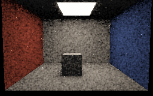
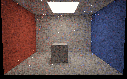
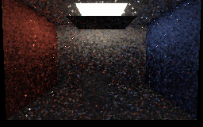
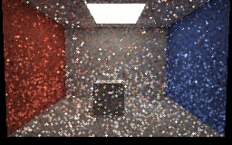

# Diffuse path-replay captures

These are four **actual Vulkan readbacks** of an authored 24-triangle scene rendered on SwiftShader CPU Vulkan,
not editor or hardware-GPU captures. These were rendered at checkpoint `6740615`, before the subsequent
history-count cap; see the capture log for the exact source hashes. Each pixel uses primary visibility plus
fresh, temporal and spatial random-sequence replay; paths are retraced against the current BVH. Every image averages the final 24 of 48
frames in linear RGB, then applies exposure 0.45 and display gamma 2.2. No denoising was applied. The noise
and occasional bright speckles, particularly after reopening, are genuine limitations of the current reuse
scheme rather than evidence of calibrated quality.

| One hit (open) | Four hits (open) |
|---|---|
|  |  |

| Four hits, blocker moved under lamp | Four hits, blocker moved away again |
|---|---|
|  |  |

The moving-blocker sequences reused history without a global reset: 35,886 temporal records were accepted
on each transition and more than 147,000 spatial links were considered. A fixed lower-image region had mean
linear luminance 0.4534 for one hit, 0.5636 for four hits open, 0.0202 blocked, and 0.5445 reopened. This is a
sanity check on the authored scene, not an independent photometric reference or a claim of statistical
independence between pixels/frames. The images and averages are not the numerical validation fixtures in
[PathReplay.md](PathReplay.md).

Reproduce with `bash Exhibits/LightCompute/RunPathReplayCapture.sh` after preparing the pinned tools with
`python3 Exhibits/LightCompute/Code/Prepare.py`; Pillow is needed for PNG conversion. The original run's
rendering completed successfully but the converter initially selected a Python without Pillow; conversion was
resumed from the unmodified PPM readbacks, and the script now selects the repository virtual environment when
available. [Capture log](Results/PathReplay-capture.txt).
