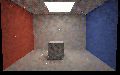

# Subpixel seed candidates with replay reservoirs

**Status:** opt-in bounded research path, not complete ReSTIR GI. Unselected prior seeds can now enter the same
reservoir as a fresh path and a temporal reservoir; the resulting reservoirs can also be spatially reused. All
seeds are retraced at the current receiver through the current software triangle BVH. No old radiance or old
visibility answer is copied. This is not hardware RT, an editor viewport, general animated reconstruction, or a
physical-GPU performance result.

## Contract

- **Enablement:** set both `PathReplaySampleHistory` and `PathReplaySampleHistoryCandidates`. The original
  sample-history-only mode is unchanged and still excludes reservoir reuse.
- **Domain:** validated static, untextured, opaque diffuse scene; one fresh initial candidate; up to eight replay
  bounces. Primary visibility and the existing diffuse camera-domain validation are required.
- **Revisions:** reset the seed bank on first use, reallocation, enabling/disabling, sampling/reuse-policy changes
  and every scene revision except a certified camera-only transition. Set
  `PathReplayHistorySpecification::SampleHistoryCandidates` to match the dispatch flag so a toggle also caps the
  reservoir's represented history. Reset/invalidate after failed submission.
- **Reprojection:** the previous projection must identify the last completed camera. Position, token, normal and
  seed-bank guards apply. Matching a token/position does not prove general disocclusion safety. Geometry, lighting
  or material changes reset the seed bank.
- **Exclusions:** no colour reconstruction, rough/textured replay, audit double-counting, multiple fresh
  candidates, general deforming motion or concurrent reuse of the same history storage.
- **Storage:** `PathReplayRequiredSampleHistoryOutputRecords(N)` float4 records, 24 counter words and the two
  sample-history pipelines. The recorder orders primary → seed gather → reservoir generation → resolve → seed
  finalize, with compute dependencies. The caller owns resources, descriptors, input/final barriers, queue
  ownership, submissions and successful history lifecycle.

The gather copies at most three **fresh, unselected** seeds from a compatible previous pixel. Generation retraces
and resamples them with one fresh draw and an optional temporal reservoir; spatial resolve can then resample its
neighbors. Finalize stores the first fresh draw, recomputed from the frame/pixel seed, rather than the selected
reservoir winner. The original `PathReplaySampleHistory` mode instead averages retraced paths after resolve.

The seed bank and reservoirs can represent overlapping original draws. Correlations, adaptive histories and the
finite 32-bit pseudorandom streams are not proven independent. Candidate and spatial paths incur additional traces;
the history requires previous frames and storage traffic. Neither lower error in a fixture nor equal current-path
counts establishes an equal-time improvement, a general unbiasedness proof or real-time performance.

## Exact finite-domain audit

`ReplaySeedDomainAudit.cpp` exhaustively enumerates two prior draws, one current draw and both weighted selections
on a small common random-number domain. The bank retains one of the original draws without selection; the temporal
reservoir can include that same draw. A strictly positive target floor is used.

| Visibility case | Exact      | Unselected, full / capped | Incorrectly stored winner |
| --------------- | ---------: | ------------------------: | ------------------------: |
| Inverted        | `0.500000` |     `0.500000 / 0.500000` |                `0.450000` |

Additional dark-to-bright, unequal and unchanged finite domains are enumerated. This explains why the bank must not
store the old winner as though it were an unselected candidate; it does **not** prove adaptive GPU reuse, arbitrary
spatial shifts or the random-stream properties of the full renderer.

## SwiftShader numerical validation

The `32 × 32` half-pixel fixture contains a diffuse plane, opaque blocker and two-triangle emitter. A prior bank is
retained for `970` pixels; all `22` changed-token temporal donors are rejected and those pixels have one fresh local
candidate. Spatial donors may still contribute. Temporal replay accepts `970` histories and spatial resolve uses
`3,968` links. Three checked retained paths have different old/current visibility and use the current answer.

An independent C++ rectangle-intersection oracle and mirrored selection sequence reconstruct `819` local and `818`
spatial outputs with zero maximum discrepancy in the tested fixture; seven local edge/decision-ambiguous points are
excluded. The oracle reads previous reservoir weights and mirrors the PRNG, so it checks composition and geometry,
not independent randomness. Corrupt-bank rejection, mode/policy changes, caps, moving-blocker reset and a paired
forced-reset control also pass. When the emitter is turned off, the result is black and the seed bank resets;
relighting resets it again.

### Four bounces

A separate brute-force C++ tracer uses `mt19937_64`, a different cosine basis and `512` paths per point, or
`406,528` CPU paths over `794` plane points. Sixteen seed batches compare a four-fresh-candidate control with the
combined mode; **both also enable temporal and spatial replay**. At fully retained points the combined mode uses one
fresh and three retained current-frame candidate paths. Warm-up work differs and the comparisons are not equal-time.

| Red result | CPU model             | Fresh + reservoirs    | Seeds + reservoirs    |
| ---------- | --------------------: | --------------------: | --------------------: |
| Mean ± SE  | `0.117554 ± 0.000478` | `0.117010 ± 0.001436` | `0.117232 ± 0.001206` |
| RMSE       |                     — |            `0.091760` |            `0.079130` |

The GPU mean standard errors are nominal batch estimates; RMSE is against the finite CPU point means.

The paired combined-minus-fresh mean is `0.000222 ± 0.001315` nominal batch SE. The CPU mean SE assumes the
per-point streams are independent; the same finite CPU reference is shared by the batches. These uncertainties and
RMSEs are fixture-specific; correlated streams and rare bright tails remain unresolved.

### Explicit emissive-facet sampling

A separate one-bounce half-pixel fixture compares the same two reservoir modes to independent `128 × 128` emitter
quadrature; `64 × 64` versus `128 × 128` quadrature has red RMSE `0.000290`. Over 16 batches and 794 points:

| Red result      | Area integral | Fresh + reservoirs    | Seeds + reservoirs    |
| --------------- | ------------: | --------------------: | --------------------: |
| Mean ± batch SE |    `0.106269` | `0.106129 ± 0.000107` | `0.106245 ± 0.000142` |
| RMSE            |             — |            `0.011036` |            `0.012329` |

RMSE is measured against the area integral; batch standard errors are nominal.

The combined mode is **worse in this particular RMSE comparison**, illustrating why the four-bounce result is not a
universal quality or speed claim. The explicit-source fixture uses uniform emissive-facet sampling; weighted and
mixture policies have not been independently tested with this new composition.

## Actual room readbacks

The two radiance images are direct `120 × 75` SwiftShader CPU-Vulkan readbacks of a four-bounce diffuse room after
three warm-up frames and a `0.03`-unit camera translation. Both enable temporal and spatial reservoirs and uniform
emissive-facet sampling. The first uses four fresh current candidates; the second uses one fresh and up to three
retained seed candidates. Exposure is `0.45` with the existing display transform; no denoising or manual painting is
applied. The acceptance image is a **CPU-generated diagnostic mask** from GPU guides and seed-bank counts, not a
radiance readback: green = three retained seeds, blue = partial, red = rejected, black = background. Counts were
`8,107` full, `0` partial, `92` rejected and `801` background pixels; the combined capture reports `8,107`
temporal histories and `32,414` spatial links. These are not production-editor images.

**Four fresh + reservoirs:**


**Seed candidates + reservoirs:**



**Seed-bank acceptance:**


## Regression checks

Both release and host ASan/UBSan runs passed all six CTests and the new Vulkan checks. Their reported numerical
rows and all three PNG byte streams matched. The original sample-history suite was run before and after the change:
its numerical output and all four captured PNG byte streams matched exactly. The existing candidate suite passed,
and its default-off comparison to checkpoint `b0cf5c9` yielded 20 matching readbacks, eight matching histories
and zero differing float bits across 655,360 components. The strict camera-reconstruction suite also passed with
numerical rows matching the latest prior regression and three PNGs identical to the recorded captures. Those
comparisons cover the tested cases, not every possible material, scene or device.

[Original suite before](Results/ReplaySeedCandidates-original-before.txt) ·
[Original suite after](Results/ReplaySeedCandidates-original-after.txt) ·
[Existing reservoir and shader parity](Results/ReplaySeedCandidates-existing-replay.txt) ·
[Strict camera regression](Results/ReplaySeedCandidates-camera-regression.txt).

## Reproduce

Requires the repository's prepared Slang, Vulkan headers and SwiftShader; CMake, a C++20 compiler and Pillow for
captures. `Exhibits/LightCompute/Code/Prepare.py` restores the pinned Linux x86-64 tools into ignored storage. The
recorded runs use GCC 12.2, Slang 2026.14.1 and SwiftShader CPU Vulkan. Host ASan/UBSan does not instrument the
external Vulkan driver or generated shader code.

```bash
CAPTURE=1 BUILD_JOBS=1 bash Exhibits/LightCompute/RunReplaySeedCandidates.sh
SANITIZE=1 CAPTURE=1 BUILD_JOBS=1 bash Exhibits/LightCompute/RunReplaySeedCandidates.sh
```

[Release results](Results/ReplaySeedCandidates-release.txt) ·
[Host sanitizer results](Results/ReplaySeedCandidates-sanitized.txt) ·
[Original arithmetic-mean mode](ReplaySampleHistory.md) · [Engine recorder contract](PathReplayEngine.md).
