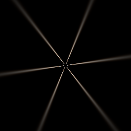
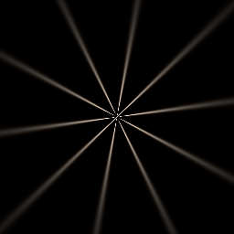
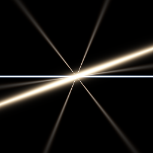

# Isolated starburst and simultaneous lens-flare layers

The **existing experimental Vulkan** solar shader was tested in isolation; this checkpoint does not add an editor
feature or claim a physically calibrated lens. The retained demo has a different parametric burst. These 256×256
images are SwiftShader CPU Vulkan readbacks against black, with the solar disc and other flare layers disabled
except where noted. Exposure is `0.45`, followed by `1-exp(-L×exposure)` and gamma `2.2`.

| Six blades | Five blades | Six blades + warm streak + blue anamorphic |
| --- | --- | --- |
|  |  |  |

| Isolated check | Result |
| --- | --- |
| Six-blade aperture | Six spike regions at 25% of ring peak; maximum angular alignment error `0.00263` rad |
| Five-blade aperture | Ten spike regions; maximum alignment error `0.00263` rad |
| Rotate six-blade aperture by `0.2` rad | Six rotated regions; maximum alignment error `0.00539` rad |
| Six-blade pixels vs native double implementation | Max RGB error / CPU peak `8.59e-6` |
| All three layers vs sum of isolated layers | Max RGB difference / mixed peak `4.30e-8` |
| Opaque cover of source | All three layers blocked; readback peak zero |

Spike counts are measured after bilinear ring sampling at normalized radius `0.5`, with a nine-sample angular
average. The native comparison checks the implementation of the same analytic model; it is **not** an independent
measurement of a real lens. Rotations and blocked-source tests use synthetic geometry. Partial solar visibility
and the pre-existing warm/blue additive tests also pass in the existing solar regression, rather than being
repeated as a starburst-specific physical-lens calibration.

Release and ASan/UBSan host tests pass; the external driver is not sanitizer-instrumented. All three sanitized
PPM readbacks are byte-identical to release. The PNGs were decoded and inspected. This says nothing about a
physical GPU, real-time cost, arbitrary transparent or volumetric occluders, texture-based diffraction, camera
calibration, or editor integration.

```bash
bash Exhibits/LightCompute/RunSolarStarburst.sh
SANITIZE=1 bash Exhibits/LightCompute/RunSolarStarburst.sh
```

[Release results](Results/SolarStarburst-release.txt) · [Sanitized results](Results/SolarStarburst-sanitized.txt) ·
[Existing solar regressions](Results/SolarStarburst-regression.txt) · [Broader solar optics](SolarOpticsAndReuse.md).
