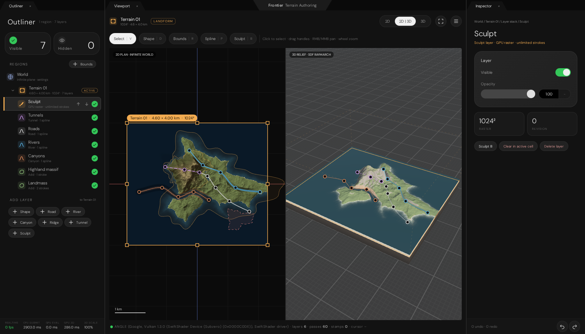
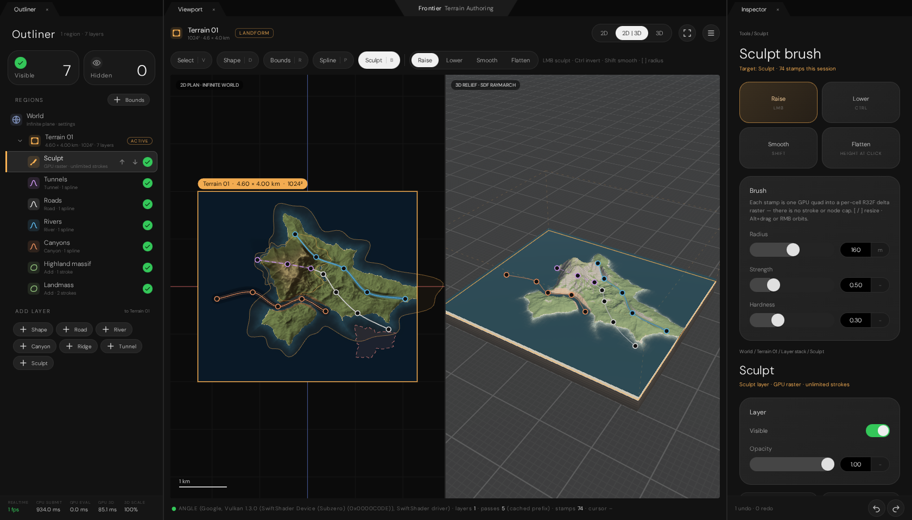
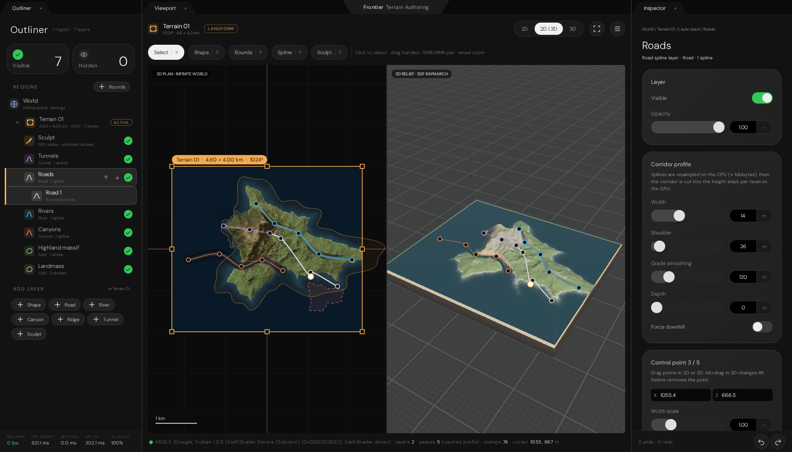
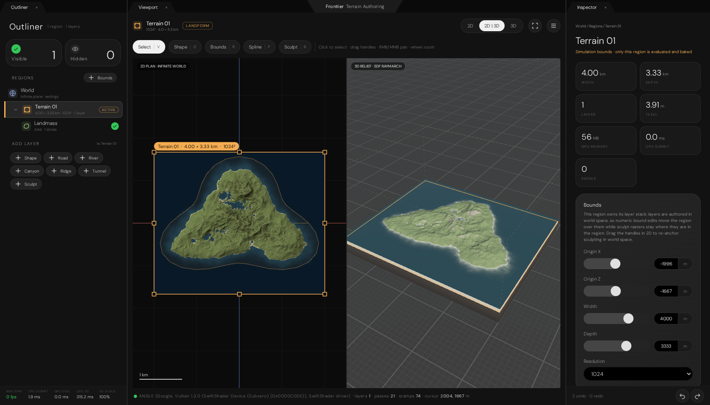
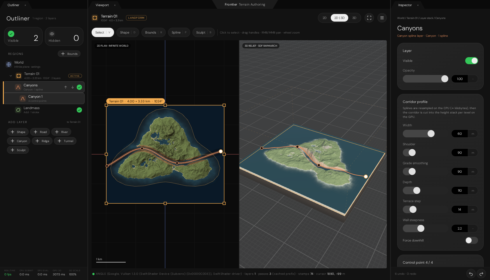
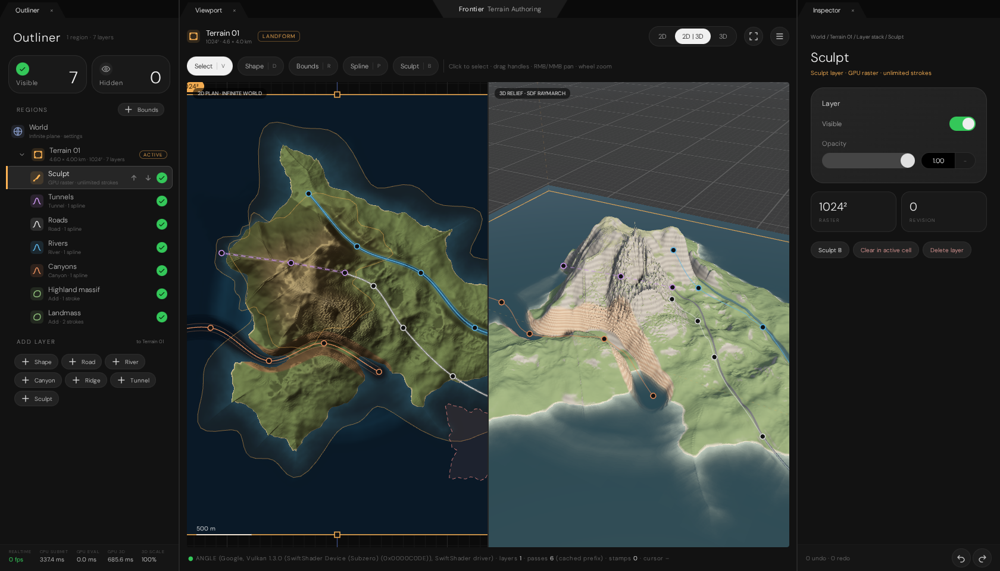
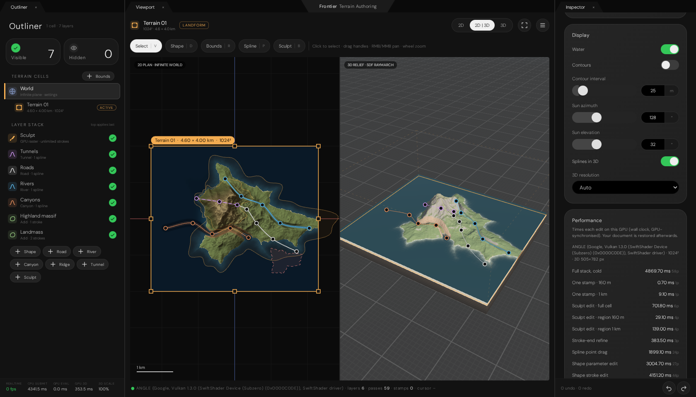
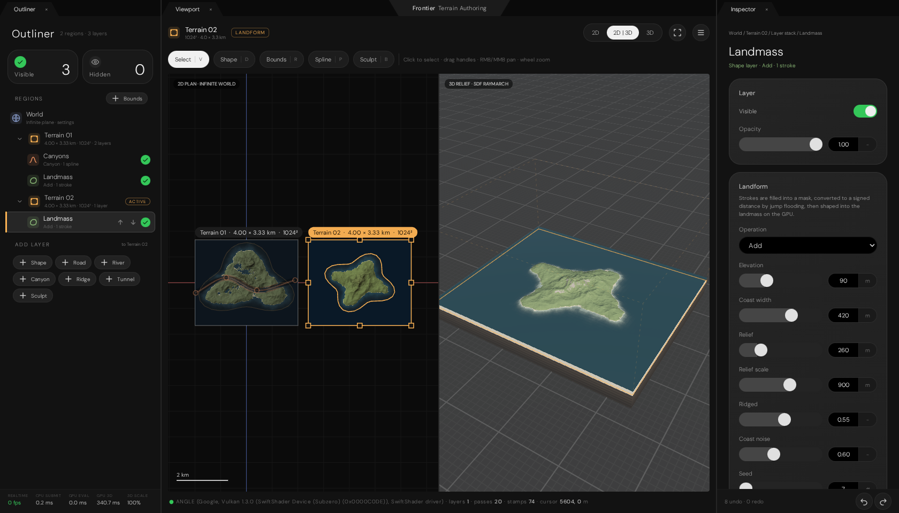

# Terrain authoring validation — 2D plan, splines, unlimited GPU sculpting, SDF vs voxels

Evidence for the [Terrain Authoring prototype](../../Experimental/TerrainAuthoring/README.md). All runs are headless
Chromium 2026 with ANGLE → **SwiftShader (CPU)**, no physical GPU. Timings below are CPU-emulated and are an
upper bound for relative cost, not a real-GPU frame budget; run *World → Performance → Run edit benchmark* in the
prototype on the target machine for real numbers (same code: `Source/PerformanceProbe.js`).

## Decision — stay with SDF, do not switch to voxels

| Criterion | Layered SDF stack (height-field SDF per cell) | Dense voxels | Sparse brick SDF |
|---|---|---|---|
| Memory, 4.6 × 4 km cell @ 4.5 m | ✔️ 89 MB GPU (measured, all fields + caches) | 🔴 ~750 MB for 1600 m height (16-bit) | 🚩 depends on surface area |
| Sculpt cost | ✔️ O(brush area), no cap (measured below) | 🚩 O(brush volume) | 🚩 O(brush volume), brick allocation |
| Non-destructive splines / shapes after sculpting | ✔️ layers re-evaluate in order | 🔴 destructive: edits are baked into voxels | 🔴 same as voxels |
| Overhangs, tunnels, arches | 🚩 not alone — needs a 3D volume | ✔️ | ✔️ |
| Erosion / hydrology later | ✔️ standard algorithms are 2.5D | 🔴 hard and slow | 🚩 hybrid |
| Bake target | ✔️ height grid directly; mesh/voxels at bake time | 🚩 needs surface extraction | 🚩 needs surface extraction |
| Large worlds | ✔️ per-cell fields, idle refresh | 🔴 memory bound | 🚩 streaming bricks |

- 💡 Keep **SDF**, structured as: non-destructive 2.5D layer stack (signed distance `y − h(x, z)`) evaluated on the
  GPU per terrain cell, plus **sparse 3D SDF volumes only where geometry is truly 3D** — tunnels now (implemented),
  Rock Studio cliffs / overhangs later. Voxels (or meshes) are a **bake output**, never the authoring format.
- ⚠️ The earlier "sculpting limit reached" was not an SDF limit: each stroke was a CSG primitive evaluated per
  ray step (`SdfMath.js:445`, `MAX_CSG_NODES = 24` in `eosclient0001-rgb/Frontier@a2fff41`). Here strokes are
  rasterized.

## Interaction validation — 6 / 6 pass

Real pointer and keyboard events through the UI
(`Code/InteractionValidation.mjs`, `Results/InteractionValidation.json`).

| Check | Result | Detail |
|---|---|---|
| Sculpt stroke in 3D | ✔️ PASS | sculpt raster revision 0 → 74, 74 stamps, one undo entry `Sculpt (74 stamps)` |
| Sculpt undo / redo | ✔️ PASS | mean cell height −33.6607 → undo −33.7995 → redo −33.6607 m |
| Spline point drag in 2D | ✔️ PASS | road point moved 711 m; all 8 drag ticks evaluated as Region (cached layer 4) |
| Empty world → stroke → bounds | ✔️ PASS | stroke drawn while unassigned; the 4000 × 3333 m region adopted it (stack: Landmass, unassigned 0) |
| Canyon spline drawn in 2D | ✔️ PASS | 1 spline, 4 control points, cut visible in 3D |
| Second region owns its own stack | ✔️ PASS | box + closed-loop stroke drawn with the mouse: Terrain 02 stack [Landmass], peak 187.2 m; Terrain 01 stack unchanged and its 1,048,576 heights differ by 0 m; Outliner nests each stack under its region |

Document migration (node, `WorldDocument.js`): a version 1 file with layers in region A, in region B, outside both
and without geometry loads as A [shape, sculpt], B [road], Unassigned [far shape]; re-encoding writes version 2
without a world-wide stack; a new box over the far shape adopts it.

- 🐞 Found by the second-region check: a stroke closed exactly on its start pixel condensed to 2 points
  (point-to-line distance is 0 on a zero-length chord) and vanished. `CondenseStroke` now uses point-to-segment
  distance (41-point closed loop keeps 41, a straight 21-point line still condenses to 2).

## Edit cost — SwiftShader CPU emulation, median of 3–9

`Code/TimingValidation.mjs` → `Results/TimingValidation.json`. Each row is wall clock between two blocking 1-texel
readbacks; 3D viewport 505 × 782 px. "Calibration passes" divides by one trivial full-cell write, a rough
GPU-independent work unit.

| Operation | 512² ms | 1024² ms | Passes (1024²) | 1024² in calibration passes | 1024² before (ms) |
|---|--:|--:|--:|--:|--:|
| Full stack, cold (all 6 layers + derived) | 925.7 | 3107.7 | 61 | 1002 | 4696.7 |
| One sculpt stamp, 160 m brush | 0.4 | 0.5 | 1 | 0 | 0.7 |
| One sculpt stamp, 1 km brush | 2.2 | 8.3 | 1 | 3 | 8.4 |
| Sculpt edit, full-cell re-evaluation (reference) | 394.5 | 729.7 | 6 | 235 | 760.8 |
| **Sculpt edit, region evaluation, 160 m** | **7.7** | **27.4** | 4 | 9 | 26.8 |
| Sculpt edit, region evaluation, 1 km | 31.0 | 124.7 | 4 | 40 | 135.4 |
| Stroke-end refine (full shadows / AO, once) | 74.8 | 316.3 | 3 | 102 | 370.1 |
| **Canyon point drag (spline region, binned)** | **102.3** | **371.8** | 22 | 120 | 1847.0 |
| Landmass parameter edit (noise cache) | 510.8 | 1054.8 | 27 | 340 | 2973.2 |
| Landmass stroke edit (JFA rebuild, noise cache) | 688.3 | 1984.0 | 44 | 640 | 3866.6 |
| 3D raymarch, full res | 223.1 | 300.6 | 1 | 97 | 294.7 |
| 3D raymarch, half res | 62.5 | 84.2 | 1 | 27 | 81.5 |

All exactness checks compare against a forced full evaluation on every texel:

| Check | Max height difference | Scope |
|---|--:|---|
| Sculpt region vs full | ✔️ 0.0 m | 40 region stamps, 1,048,576 texels |
| Spline region vs full | ✔️ 0.0 m | 16 edits (12 point moves, add / move / remove spline, Width × 1.3), all 16 took the region path |
| Spline binning vs one exhaustive bin | ✔️ 0.0 m | 96 bin entries, all spline layers |
| Landmass noise cache + ocean skip vs inline noise | ✔️ 0.0 m | 1,048,576 texels |
| Noise cache after a stroke point grows 600 m outward | ✔️ 0.0 m | cached rectangle extended under a scissor |

- Region evaluation is **exact**: after 40 region-evaluated stamps, the height stack differs from a forced full
  evaluation by **0.0 m** on all 262,144 (512²) and 1,048,576 (1024²) texels. Shadows are range-limited during the
  stroke (400 m relief) and restored by the stroke-end refine.
- Spline region: each spline's footprint (samples + shoulder reach) is kept per layer; an edit re-rasterizes only the
  union of old and new footprints of the changed splines (48.5 % of the cell for the canyon drag, 4 layers).
- Spline binning: groups are binned per 32 × 32 texel tile on the CPU, so the corridor query cost follows local
  spline density instead of the total group count (roads 491.6 → 75.6 ms, rivers 429.2 → 84.8 ms per full apply).
- Landmass noise: coast feather and relief noise (19 octaves) are cached per shape layer in an RG32F texture over the
  stroke bounds plus feather reach; ocean texels skip the layer exactly. Two landmass applies: 1273 → 51 ms.
- 🚩 Landmass stroke edits are dominated by the jump-flood distance rebuild (FloodStep 761–772 ms of 1984 ms, 12 full
  passes). Next step: exact analytic polyline distance with segment binning, which makes a shape region path exact.

## No sculpting limit — 3,000 stamps

| Stamps done | 300 | 900 | 1,500 | 2,100 | 2,700 | 3,000 |
|---|--:|--:|--:|--:|--:|--:|
| ms / stamp (SwiftShader) | 0.201 | 0.196 | 0.193 | 0.195 | 0.192 | 0.196 |

GPU memory of the cell is **88,964,864 bytes before and after** 3,000 stamps. Cost per stamp is flat and nothing is
allocated per stroke; undo stores only the stroke's bounding rectangle as a GPU texture (64 entries).

## Images

| | |
|---|---|
|  |  |
| Example world: 2D plan with cell bounds and handles, 3D relief with road / river / canyon / tunnel | After a 74-stamp 3D sculpt stroke |
|  |  |
| Road control point dragged 711 m in 2D | Empty world → freehand shape → bounds box → live terrain |
|  |  |
| Canyon spline clicked in 2D, cut in 3D | 3,000-stamp spiral on the massif (ring ridges) |
|  |  |
| World → Performance: the same probe run from the UI before the spline / landmass optimizations | Two regions, each with its own layer stack nested in the Outliner; region 2 drawn with the mouse |

## Reproduce

```sh
cd Experimental/TerrainAuthoring && python3 -m http.server 8080 --bind 0.0.0.0 &
# CaptureRunner.mjs needs puppeteer-core + @sparticuz/chromium installed next to it
node Code/CaptureRunner.mjs "http://127.0.0.1:8080/?example" out.png 9000 "$PWD/Code/InteractionValidation.mjs"
node Code/CaptureRunner.mjs "http://127.0.0.1:8080/?example" out.png 9000 "$PWD/Code/TimingValidation.mjs"
```

## Boundaries

- Browser prototype; no C++ editor, Vulkan / Slang or Windows run. No physical GPU timing.
- No erosion, simulation, Rock Studio or cross-cell seams. The heightfield bake (`.r32` + JSON) excludes the tunnel SDF.
