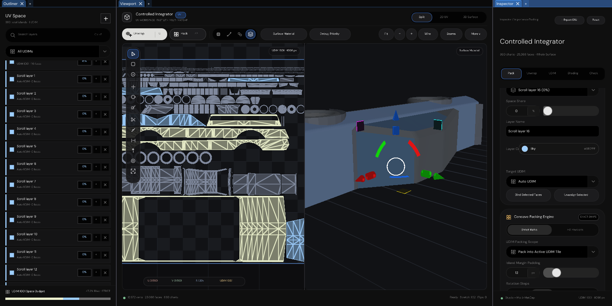

# UV wheel input repair

> **Historical wheel-only acceptance.** The 17/17 suites, 36/36 focused logs, original captures and digests below
> are retained unchanged. The later [native UV repair](../UVWorkspaceRepair/README.md) explicitly supersedes this
> five-change scope and its unchanged-input-source invariant. Do not regenerate these archived reports or run the
> strict wheel-only source audit against the broader repair. Current validation uses the installed callbacks and
> production packet-to-ImGui intake while preserving the existing exchange and the no-wrapper requirement.

The desktop host omitted `InputExtension::TickExchange()`. Wheel callbacks reached the existing input queues,
but the snapshot forwarded to ImGui remained zero. The repair drains the existing exchange immediately after polling.
**No new input wrapper, class, or wheel sensitivity change is required.**

## Result

| Verification                                      | Observed result                                      |
| ------------------------------------------------- | ---------------------------------------------------- |
| Missing-drain reproduction                        | Packet queued; wheel snapshot stays zero             |
| Existing exchange after `TickExchange()`           | Queue empty; original wheel delta restored           |
| Focused native wheel validation                   | 36/36 assertions passed                              |
| Development / Debug regression suite               | 17/17 CTests passed                                  |
| Editor / Debug with AddressSanitizer + UBSan        | 17/17 CTests passed; wheel checks also 36/36           |
| HTML reference validation                          | All 11 validation groups passed                      |
| Windows / MSVC and physical mouse interaction       | Not run; no Windows host/toolchain in this sandbox    |
| GitHub Actions                                     | Not run                                              |

Retained results: [summary](Results/Summary.json), [full Development wheel log](Results/WheelDevelopment.txt),
[full sanitized wheel log](Results/WheelEditorSanitized.txt), [Development CTests](Results/Development.xml),
[Editor sanitizer CTests](Results/EditorSanitized.xml), and [HTML validation](Results/HtmlReference.txt).
JUnit truncates successful stdout at 1,024 bytes; the separate focused logs retain all 36 assertions and measurements.

## Exact repair

`Engine/Lifecycle/DesktopWorkspaceLaunch.cpp`, immediately after `PollOperatingEvents`:

```cpp
InputCoordinator.BeginTick();
DesktopWindow.PollOperatingEvents(InputCoordinator);
(void)InputCoordinator.TickExchange();
```

```text
GLFW wheel callback
    -> DesktopPlatformWindow's InputExchange
    -> InputExtension's InputExchange
    -> TickExchange() consolidates the pointer snapshot   <-- missing in the linked host
    -> ImGuiIO::AddMouseWheelEvent
    -> native Inspector / Outliner / 2D viewport / 3D viewport
```

The call runs before the minimized-window early return, so the hardware ring also drains while minimized.
`InputExchange` and `InputExtension` themselves are unchanged from the linked revision.
The abandoned `PointerWheelExchange.h` and `.cpp` files were removed.

## Measured interactions

| Interaction                       | Before                 | After one tested input             |
| --------------------------------- | ---------------------- | ---------------------------------- |
| Inspector, three downward notches  | 0 px scroll            | 84 px scroll                       |
| Outliner, two downward notches     | 0 px scroll            | 56 px scroll                       |
| 2D viewport, one upward notch      | 1.000000 zoom          | 1.140000 zoom                      |
| 3D viewport, one upward notch      | 9.879589 m distance     | 8.088723 m distance                 |
| 2D rendered channel changes        | Original framebuffer   | 582,682 channels changed           |
| 3D rendered channel changes        | Original framebuffer   | 196,069 channels changed           |
| Continued callback input           | 1,920 callbacks        | Both axes retained; zero drops     |

Both scrolling directions, content boundaries, idle delta reset, camera independence, and header exclusion are checked.
The Outliner fixture adds 16 empty priority layers to guarantee overflow; it does not alter bundled geometry.

## Actual rendered evidence

[Before interaction](Images/Before.png) · [After scrolling and zooming](Images/After.png) ·
[Production application capture](Images/NativeApplication.png).

The after-interaction capture records Inspector scroll **168 px**, Outliner scroll **224 px**, planar zoom **1.299600**,
and spatial camera distance **6.622487 m**. The separate production application image comes from the actual Vulkan
ImGui presenter, not the exhibit compositor.



These images composite the **actual native ImGui draw lists** using the existing exhibit rasterizer.
The embedded 2D/3D images are readbacks from the **production Vulkan UV rasterizer** running on SwiftShader.
They are not HTML captures, generated mockups, or physical-GPU/Windows desktop captures.

## Continuation recovery, not an unrelated rewrite

| Source                      | Revision / location                                               |
| --------------------------- | ----------------------------------------------------------------- |
| Requested linked branch     | `SultanAladin/Frontier`, `arena/4c9015d5-frontier`                   |
| Pinned source revision      | `624883b66512daed348c33fcb164b616c9691d46`                        |
| Session branch              | `arena/52270d91-frontier`                                         |
| Session base                | `96f31ecaef529d383e195013f5f00d163392f71a`                        |
| Tested contents             | Session base plus the uncommitted sources retained in this change |

The session checkout did not contain the linked UV application. Its required Engine sources, native validation code,
geometry, MatCaps, dependency recovery, and HTML reference were recovered alongside the older code.
No older engine, UI, prototype, or governance tree was deleted or replaced wholesale.

[Per-file SHA-256 audit](Results/Continuation.json): **262 of 267 recovered files remain byte-identical** to the source.
The five differences are the desktop repair and read-only scroll inspection methods in the two panel headers/sources.
Those methods expose the already-existing scroll offsets for assertions; they do not change scrolling behavior.

`Automation/UVWorkspace.cmake` preserves the linked application's build configuration separately.
`FRONTIER_BUILD_UV_WORKSPACE=ON` selects it; a supplied `FRONTIER_PROFILE` also enables it in a fresh build.
The earlier UI-only CMake targets remain available with `FRONTIER_BUILD_UV_WORKSPACE=OFF`.
`PrepareUVFonts.py` and `UVFontSources.json` retain the continued font catalogue without replacing older recovery.

## Reproduce on Windows / MSVC

Use a fresh build directory so an older executable cannot mask the fix. This example uses Visual Studio 2022:

```powershell
python -m pip install -r Automation/FontRequirements.txt
python Automation/PrepareDependencies.py
python Automation/PrepareShaderToolchain.py
python Automation/PrepareUVFonts.py
cmake -S . -B Build/UVWheel -G "Visual Studio 17 2022" -A x64 `
    -DFRONTIER_BUILD_UV_WORKSPACE=ON -DFRONTIER_PROFILE=Editor -DBUILD_TESTING=ON
cmake --build Build/UVWheel --config Release --parallel 2
ctest --test-dir Build/UVWheel -C Release --output-on-failure
.\Build\UVWheel\Release\FrontierUV.exe
```

Manually wheel over the Inspector body, an overflowing Outliner, the 2D canvas, and the 3D canvas.
Wheel up/down should reverse scrolling or zoom; wheel over a side panel must not zoom the viewports.
`FrontierEditor.exe` uses the same corrected desktop loop. The Windows commands above have not been run here.

## Reproduce local host verification

Prerequisites: CMake, Ninja, GCC/Clang C++20, Python with `fonttools`, Node.js, and the pinned recovered dependencies.
These are verification tools, not a Linux product delivery.

```bash
python3 Automation/PrepareDependencies.py
python3 Automation/PrepareShaderToolchain.py
python3 Automation/PrepareUVFonts.py
cmake -S . -B _ClaudeScratch/build/UV -G Ninja \
  -DFRONTIER_BUILD_UV_WORKSPACE=ON -DFRONTIER_PROFILE=Development \
  -DBUILD_TESTING=ON -DCMAKE_BUILD_TYPE=Debug
cmake --build _ClaudeScratch/build/UV --parallel 2
ctest --test-dir _ClaudeScratch/build/UV --output-on-failure \
  --output-junit "$PWD/Exhibits/UVInput/Results/Development.xml"
node Experimental/UVEditor/UVValidation.mjs
```

The focused executable is `WheelInputValidation`; its optional argument selects a PNG output directory.
It invokes the window's **registered GLFW callback**, polls both existing exchanges, and consolidates input through
`TickExchange()`. It then queues the snapshot to ImGui and renders the real docked panes.
A source-order assertion additionally guards the actual desktop caller against omitting that consolidation again.
The negative control replays the linked host's missing-drain sequence before exercising the repaired sequence.
No fabricated `PaneInputReading` is used for the wheel interactions.

The second accepted build uses the same sources with the Editor profile and address/undefined-behavior instrumentation:

```bash
cmake -S . -B _ClaudeScratch/build/UVEditorSanitized -G Ninja \
  -DFRONTIER_BUILD_UV_WORKSPACE=ON -DFRONTIER_PROFILE=Editor \
  -DBUILD_TESTING=ON -DCMAKE_BUILD_TYPE=Debug \
  '-DCMAKE_CXX_FLAGS=-fsanitize=address,undefined -fno-omit-frame-pointer' \
  '-DCMAKE_C_FLAGS=-fsanitize=address,undefined -fno-omit-frame-pointer'
cmake --build _ClaudeScratch/build/UVEditorSanitized --parallel 2
ASAN_OPTIONS=detect_leaks=0:halt_on_error=1 UBSAN_OPTIONS=halt_on_error=1 \
  ctest --test-dir _ClaudeScratch/build/UVEditorSanitized --output-on-failure \
  --output-junit "$PWD/Exhibits/UVInput/Results/EditorSanitized.xml"
```

Leak detection is disabled globally in these driver-backed runs. Address and undefined-behavior checks remain active;
no memory-leak acceptance is claimed. The independent full focused runs are retained beside the CTest reports.
`Code/CollectResults.py` packages those local logs and losslessly compresses the PNGs using Pillow, verifying that the
captured RGBA pixels do not change. `Results/Summary.json` records source and image digests.

For the source audit on a fresh clone, fetch the pinned Git object first, then run:

```bash
git fetch --no-tags --depth=1 https://github.com/SultanAladin/Frontier.git \
  624883b66512daed348c33fcb164b616c9691d46
python3 Exhibits/UVInput/Code/InspectContinuation.py
```

## Scope and limitations

- Tested host: Linux x86-64, GCC 12.2, C++20, CMake 4.4.4, Ninja 1.13.2, Python 3.11, GLFW null platform, SwiftShader.
- Native application smoke tests also execute the real `FrontierUV` and `FrontierEditor` presentation loops.
- Callback replay is synthetic at the GLFW callback boundary; it does not prove physical Windows event delivery.
- SwiftShader prints inherited unsupported-capability `4427` warnings. No new warning suppression was introduced.
- No new Windows executable was built, packaged, or runtime-verified; Windows interaction remains an acceptance step.
- No commit, push, pull request, or GitHub Actions run was performed.
