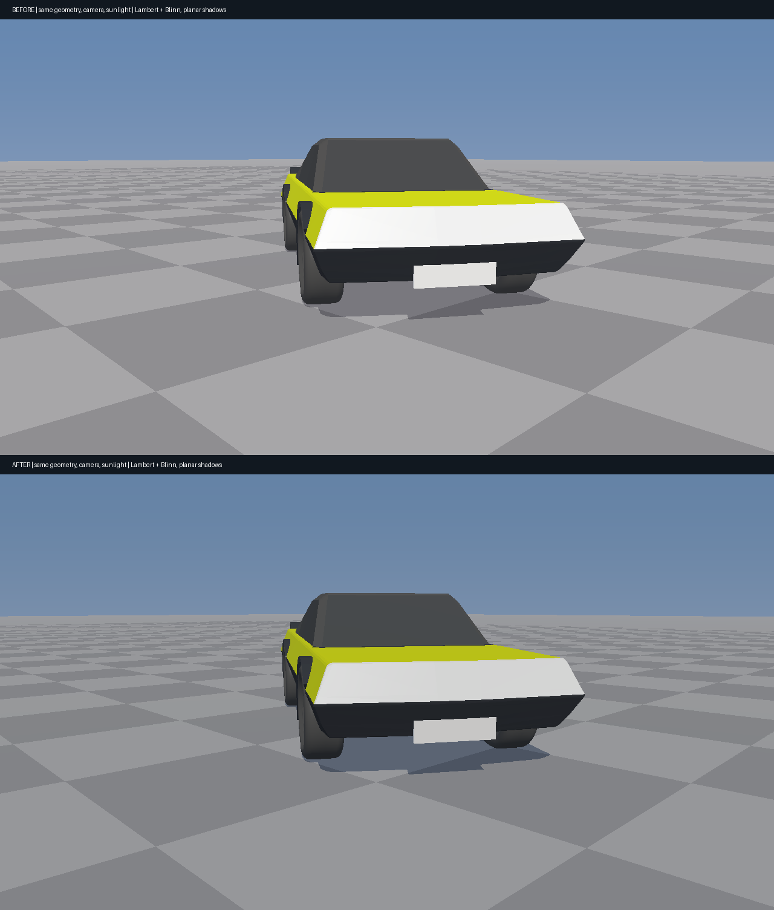
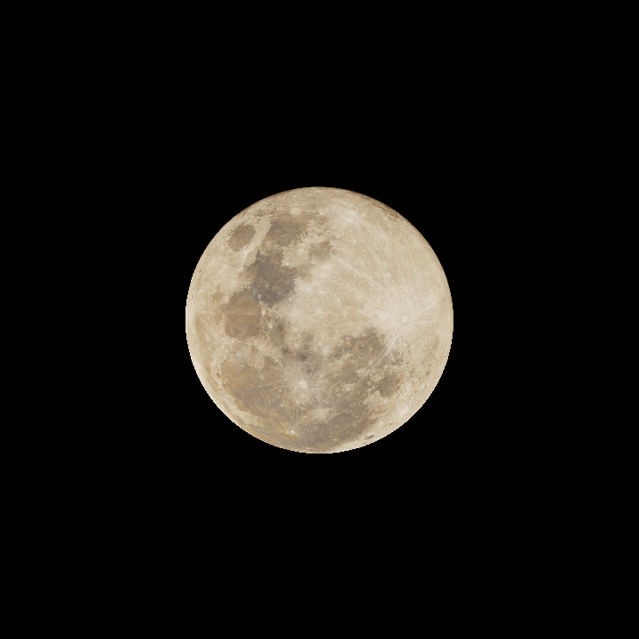
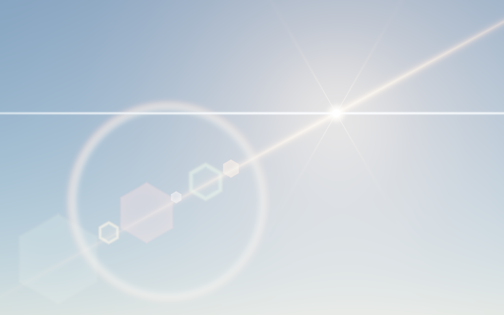

# VehicleHMI continuation — source audit and measured rendering changes

Continued from `arena/2ac8ddab-frontier` at `ae0bb7d`, on `arena/2711375f-frontier`.
Tested 2026-10-27, GCC 12.2 / Node 22.22.3 / Linux CPU. No Windows binary, GPU or editor acceptance is claimed.

## The important correction

The previous audit inspected incomplete local demo copies. The owner's actual VehicleHMI reference,
`SultanAladin/Frontier` at `6afb6f00b5f25c45f7cda92c7da65b64845768f3`, **does contain** the missing features.
Selected original sources and their hashes are now retained in `Experimental/VehicleHmiReference/`.

| Question | Verified result |
|---|---|
| Several simultaneous flares? | Yes: warm rotatable streak, blue anamorphic, burst, ghosts and halo |
| Soft analytical Sun? | Yes: full demo has a limb-darkened, footprint-softened disc, not only the old hard step |
| Moon textures? | Yes: six-body 2K atlas and individual JPEGs; actual Luna source now retained and used |
| XPBD tyre? | Yes: full demo has a 160-particle XPBD implementation plus two continuum variants |
| What was previously ported? | Older spring/vehicle/slip/thermal sources; new custom 84-particle C++ lattice |
| Does older physics source match? | Old project's VehicleSolver/TyreSlipSolver are byte-identical to local SlateReference |
| Is custom C++ XPBD the demo port? | No. Different topology, constraints and force formulation |
| Is either verified against real tyre measurements? | No. Existing checks establish source parity and internal invariants |

Recovered XPBD uses compliant distance corrections and prescribed deformation targets. Its returned reaction is
exactly `deflection × (25000 + 0.88 × pressure)`, rather than summed constraint reactions. Twelve independent pressure/
deflection cases confirm this. The continuum variants also retain prescribed reaction laws. Consequently, blindly
replacing the current solver with the demo would not establish a more realistic force model.

**The full 160-particle XPBD/continuum port remains open.** Existing physics is preserved, not silently relabelled.
The original five full-demo tests now run locally. The spring-model C++ suite still passes all 29 checks.

## Changes delivered

| Area | Change | Limit |
|---|---|---|
| Atmosphere | Cornette–Shanks aerosol phase, matching the full demo | Multiple scattering still approximate |
| Flare | Independent warm streak port, mixed with existing blue anamorphic and other components | CPU model only |
| Sun | Retained limb-darkened erfc disc; corrected claims about blur accuracy | Not a full 2D PSF convolution |
| Moon | Real 2048 × 1024 demo JPEG retained; runner regenerates PPM | Luna only; licensing needs review |
| Moon colour | sRGB decoded before interpolation | Not absolute reflectance calibration |
| Cheap lighting | Lower, cooler hemispherical fill improves surface contrast | Artistic Lambert/Blinn lighting |
| Cheap shadows | Remove direct-light share while retaining blue skylight; guard grazing/below-ground Sun | Planar ground only |
| Highlights | Exposure before Reinhard instead of after it | Gamma 2.2 display remains approximate |
| Raster cost | Skip negligible matte highlights; reuse view distance for haze | No new buffers or extra rendering rounds |

The cheap renderer remains `Exhibits/VehiclePhysics/Code/SceneRender.cpp`, **not** a production Vulkan render path.
There is no PBR BRDF, shadow map, SSAO or ray tracing added. Its background is still the inexpensive gradient;
production atmosphere/optics are exercised by the separate NightSky exhibit, not integrated into this cheap renderer.
Ground shadows still multiply some haze along with the surface; no self-shadowing or soft penumbrae are claimed.
Near-plane triangle clipping remains missing. Glass is opaque. Existing authored geometry/material IDs are unchanged.

## Actual captures







## Verification

| Check | Result | Retained evidence |
|---|---|---|
| Sky, solar disc, Moon and mixed optics | 41/41 | `../NightSky/Results.txt` |
| Environment regression, release | 73/73 | `Results/EnvironmentRegression.txt` |
| Environment ASan + UBSan | 73/73, no diagnostics | `Results/EnvironmentSanitized.txt` |
| Existing production vehicle/Jolt suite | 29/29 | `Results.txt` |
| Full-demo unmodified JS tyre tests | 5/5 | `Results/FullDemoTyres.txt` |
| Recovered XPBD force/shape audit | 12/12 | `Results/ReferenceXpbd.txt` |
| Raster checks | Finite radiance, once-only shadows, blue fill, receiver rejection, grazing-Sun guard | `Results/RasterTiming.txt` |
| HDR ramp 1 / 2 / 4 / 8 | Display bytes 202 / 224 / 238 / 246, no premature white clipping | `Results/RasterTiming.txt` |

### Performance: observed, not a universal guarantee

Same GCC `-O2`, 1280 × 720, same three fixed cameras, settled production vehicle, three warmups and 27 timed draws
per run. Alternating before/after/after/before order; no concurrent workload. Timing excludes simulation, encoding
and file I/O. Old source is extracted from pinned revision `ae0bb7d`, not reimplemented.

| Measurement | Before | After |
|---|---:|---:|
| First run median | 66.354 ms | 44.072 ms |
| Reverse-order run median | 60.994 ms | 47.157 ms |
| RGB + depth + position buffers | 25,804,800 bytes | 25,804,800 bytes |

Observed median reduction **23–34%** in these paired runs. Shared-host scheduling varies; maxima are retained too.
This is not a physical-GPU benchmark or a claim of real-time engine performance.

## Reproduce

```sh
# Prerequisites: g++, ar, curl, Node; Pillow in PYTHON. First command fetches pinned Jolt 5.2.0.
PYTHON="$PWD/_ClaudeScratch/venv/bin/python" bash Exhibits/VehiclePhysics/RunVehiclePhysics.sh
bash Exhibits/VehiclePhysics/CompareRaster.sh
_ClaudeScratch/venv/bin/python Exhibits/VehiclePhysics/Code/AssembleRasterComparison.py
node --test Experimental/VehicleHmiReference/Tools/VolumetricTyrePhysics.test.mjs
node Exhibits/VehiclePhysics/Code/ReferenceTyreAudit.mjs
PYTHON="$PWD/_ClaudeScratch/venv/bin/python" bash Exhibits/NightSky/RunNightSky.sh
cmake -S Exhibits/EnvironmentPipeline -B _ClaudeScratch/build/environment -DCMAKE_BUILD_TYPE=Release
cmake --build _ClaudeScratch/build/environment -j2
_ClaudeScratch/build/environment/EnvironmentPipelineValidation
```

For the sanitized environment run, use a separate Debug build directory and
`-DCMAKE_CXX_FLAGS="-fsanitize=address,undefined -fno-omit-frame-pointer"`.
No GitHub Actions, push or pull request was initiated.
