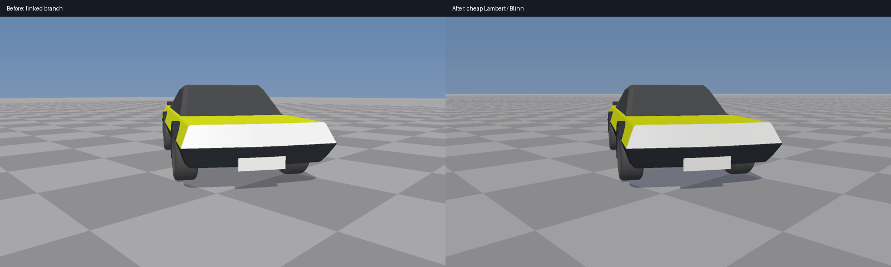

# Cheap rasterization and port audit — 2026-10-27

Continued the requested branch at `ae0bb7d5056ed6c1bcae347d5310770a5e431de5` on session branch
`arena/d66966e2-frontier`. This is a modest exhibit-renderer improvement, not a production renderer replacement.



## Rendering changes

| Change                            | Mechanism / boundary                                                        |
|-----------------------------------|-----------------------------------------------------------------------------|
| Ground holes removed              | Exact camera-ray / z=0 intersection; replaces overlapping tile triangles      |
| Distant checker contrast reduced  | Fade unresolved cells toward their mean; not full anisotropic filtering      |
| Shadows preserve ambient light    | Evaluate ground with direct Sun visibility zero; retain hemisphere and haze |
| Overlapping shadows               | Retain once-only marker in existing world-position buffer                    |
| Horizon light                     | Reject planar projection when Sun Z ≤ 0.0001; no divide-by-zero              |
| Highlight gradation               | Exposure before Reinhard, then exact sRGB; no post-tonemap ×1.5 clipping      |
| Shading cost                      | Reuse view distance for view normalization and haze                          |

Lambert diffuse, hemisphere fill and Blinn specular remain. **No PBR**, new pixel buffers, extra geometry
samples, shadow maps, SSAO, ray tracing, blur or temporal accumulation. Ground dimensions are now effectively
infinite out to 10 km view depth, rather than a camera-snapped finite apron. Vehicle geometry is unchanged.
The comparison is a matched scene, not an isolated shadow-only comparison: ground coverage and display encoding
also change. Lamp shapes remain authored and deliberately emission-scaled, not physically calibrated.

## Verification and timing

| Check                                              | Observed result                                                   |
|----------------------------------------------------|-------------------------------------------------------------------|
| Focused raster checks                              | 10/10, `Results/Raster/After.txt`                                  |
| Ray/plane coverage                                 | 57,600/57,600 downward-view pixels; pixel-centre reprojection        |
| Shadow colour, overlap, horizon, lamp retention     | Passed                                                            |
| Linear highlight levels 1, 2, 4, 8                  | Distinct encoded bytes, no clipping to 255                         |
| Actual 25,068-facet vehicle                         | Finite nonnegative HDR pixels; native 1600×900 capture              |
| ASan + UBSan                                       | Same checks passed; no diagnostics, `Results/Raster/Sanitized.txt`  |
| Native physics / JS oracle / Jolt                   | 29/29; `Results/Audit/Physics.txt`                                 |
| Native sky / disc / Moon / flare                    | 33/33; `../NightSky/Results.txt`                                   |
| Native environment regression                      | 73/73; `Results/Audit/Environment.txt`                              |
| Sky captures after restoring missing lunar source  | All eight PNGs unchanged from the linked branch                    |

Single-threaded native CPU rasterization, GCC 12.2.0, `-O2 -DNDEBUG`, sandbox Linux x86-64, Jolt 5.2.0.
No dependency compilation during timing. One fixed settled hero pose and camera; 3 warmups then 12 samples.
Each sample includes background, ground, vehicle triangles and projected shadows; excludes physics, file I/O,
PNG conversion **and display encoding**. Source hashes and compiler/platform are in `Results/Raster/Configuration.txt`.

| Execution order        | Baseline median | Revised median | Observed reduction |
|------------------------|-----------------|----------------|--------------------|
| Before, then after     | 125.527 ms      | 110.153 ms     | 12.25%             |
| After, then before     | 130.674 ms      | 108.444 ms     | 17.01%             |

These are local timings for this pose, not Windows/GPU/realtime claims or a guaranteed speedup across scenes.
The reciprocal order reduces one ordering bias but does not remove shared-host scheduling variability.
Memory layout remains RGB Float32 + Float32 depth + three Float32 world coordinates: 28 bytes/pixel,
40,320,000 bytes at 1600×900, excluding vector capacity, geometry and output encoding storage.

Reproduce after the physics runner prepares Jolt and the four production physics objects:

```bash
PYTHONPATH="$PWD/ExternalPackages/Python" bash Exhibits/VehiclePhysics/RunVehiclePhysics.sh
PYTHONPATH="$PWD/ExternalPackages/Python" bash Exhibits/VehiclePhysics/RunRasterValidation.sh
```

Pillow may instead be installed in the selected Python. The raster runner compiles the original source via
`git show ae0bb7d:Exhibits/VehiclePhysics/Code/SceneRender.cpp`; no maintained duplicate rasterizer exists.
`RasterValidation.cpp` includes the actual current exhibit source, including the vehicle importer and assembly.
The standalone SceneRender entry point is renamed only inside the validation translation unit.

Sanitizer command (Jolt and physics dependency objects are not sanitizer-instrumented in this check):

```bash
g++ -std=c++17 -O1 -g -Wall -Wextra -Werror -fsanitize=address,undefined -fno-omit-frame-pointer \
  -I Frontier -I _ClaudeScratch/jolt/JoltPhysics-5.2.0 -DNDEBUG \
  Exhibits/VehiclePhysics/Code/RasterValidation.cpp \
  _ClaudeScratch/vehiclephysics/{VehicleSolver,TyreSlipSolver,TyreThermalSolver,TyreCarcassLattice}.o \
  _ClaudeScratch/jolt/libJolt.a -pthread -o _ClaudeScratch/build/vehicle-raster/RasterSanitized
_ClaudeScratch/build/vehicle-raster/RasterSanitized _ClaudeScratch/build/vehicle-raster/after \
  Experimental/SlateReference/A/Exhibits/VehicleProvingGrounds/Archive
```

Environment reproduction:

```bash
g++ -std=c++17 -O2 -Wall -Wextra -Werror -I Frontier \
  Exhibits/EnvironmentPipeline/EnvironmentPipelineValidation.cpp \
  Frontier/Engine/Rendering/{AtmosphereModel,CelestialModel,CloudField,FogMedium,WeatherEffects}.cpp \
  Frontier/Engine/Rendering/{EnvironmentUnits,SubmissionOrder,TransientTargetAtlas,BarrierDerivation}.cpp \
  Frontier/Engine/Diagnostics/{LogRingStore,LogCategories,LogStream}.cpp \
  -pthread -o _ClaudeScratch/build/EnvironmentValidation
_ClaudeScratch/build/EnvironmentValidation
PYTHONPATH="$PWD/ExternalPackages/Python" bash Exhibits/NightSky/RunNightSky.sh
```

## Physics provenance — independently checked

The reference in `Docs/References.md` resolves to `SultanAladin/Frontier-`, branch
`arena/9440f4d0-frontier`, commit `338293863d7df4e585dec0c4acae45fe9c524ed5`.
Queried the recursive tree and fetched the three JS files using `gh api`; each is byte-identical to the local
`Experimental/SlateReference/A/Exhibits/VehicleProvingGrounds/Source/` copy.

| Reference file         | SHA-256                                                            |
|------------------------|--------------------------------------------------------------------|
| TyreSlipSolver.js      | `edeecb4ffcaa52e169b4610fcccd13bce47bc5be48b08aeb54da9bf243116454` |
| TyreThermalSolver.js   | `e68616622ac700de1b92a2453e7c2af90e04d42b1003ae7dabb990bee880d5bf` |
| VehicleSolver.js       | `3dd6a3b0938a7387032bc7bb84d5ddfb201498e4f5cfbb6d2093d0a2e6ec50ea` |

- Pacejka and thermal parity are supported by execution of the reference JS oracle, not just matching names.
- PB-FEM vertex comparisons use a WGSL transliteration, not execution of the original WGSL shader.
- The remote tree has no `TyreContinuumElasticity.js` / `TyreCarcassProjection.js` or separately named XPBD tyre source.
  Its existence in another revision remains unresolved; the local XPBD lattice must not be called a port.
- Inspected XPBD uses accumulated per-step multipliers and compliance / Δt², distance and volume constraints,
  plus positional contact. Those mechanisms do not establish a continuum/FEM tyre or measured-force accuracy.
- At 220 kPa, tests permit a broad 0.75–1.30× force ratio against the demo spring curve. The zero-gauge lattice is
  approximately twice as stiff beyond 20 mm. This is **calibration to another approximation**, not measured tyre data.
- Carcass spring remains the default. The lattice is selectable and tested; it does not silently replace the tyre model.
- Jolt owns loose bodies and a chassis collision proxy, while the custom vehicle solver advances at 480 Hz.
  Sculpted terrain, loose-body wheel support, the full authored hull, and real tyre measurements are not verified here.

## Sky, Sun, flare and Moon boundary

The linked branch already includes the analytic blurred limb-darkened Sun, ghosts, diffraction starburst,
anamorphic streak, halo/glow and Moon phase/orientation code. These re-ran without changing radiance formulas.
The checked-in demo sources do not establish a flare or Moon-texture port. A different demo revision may contain them.

A real defect was fixed: `EngineContent/CelestialMaps` was ignored and absent from the branch despite being required
by the sky runner. The pinned three.js source JPG and distribution licence are now retained; the runtime PPM is
regenerated automatically. Original scientific attribution and commercial rights remain unresolved:
`EngineContent/CelestialMaps/MoonAlbedoProvenance.md`. The map is photographic, not calibrated reflectance.

Physics identities and internal oracle comparisons are not field measurements. Clear-sky multiple scattering remains
an approximation; no calibrated atmospheric photograph, external ephemeris dataset, measured tyre dataset or actual
lens prescription was used. No topocentric lunar parallax, cloud appearance repair, or scene moonlight contribution.
The sky reference remains CPU-only; this work does not integrate it into Slang/Vulkan or the cheap vehicle renderer.

**Still open:** self-shadowing, arbitrary receiver surfaces, near-plane clipping for vehicle/shadow triangles,
real-lens matching, measured atmospheric/lunar calibration, Windows runtime and physical GPU acceptance.
No Actions, push or PR was performed. No executable is delivered.
