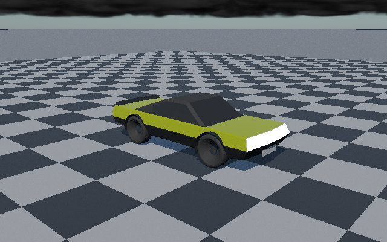

# Native ControlVehicle reference rerender

Actual C++ CPU renders of the recovered ControlVehicle body, four tyres and four rims: **25,068 original vehicle
facets**, the original 86-record material table, a checker ground, direct Sun, atmospheric environment and clouds.
Three rigid poses are rendered at 640×400 with eight accumulation frames per pose. PNG conversion preserves the
native display-encoded RGB bytes; it does not synthesize geometry or lighting.
The near checker is surrounded by a 2 km ground apron so its finite edge does not expose below-horizon sky.



## Continued renderer work

The recovered renderer used only primary-frustum-visible triangles as shadow occluders. An off-camera triangle
could therefore stop casting shadows. `TriangleVisibilitySpace` now builds balanced triangle bounds from the
entire scene when `SetScene` is called, independently of primary culling. Both fresh and spatial shadow queries
use that scene-space visibility structure. Primary raster culling and existing reservoir/filtering code stay intact.

| Verification | Observed result |
|---|---|
| Independent long-double exhaustive interval oracle | 8,192 comparisons, no mismatches or exclusions |
| Axis rays, interval endpoints, empty/rebuilt and invalid inputs | Passed |
| Off-camera shadow regression using original renderer | Fails as expected; `RegressionBefore.txt` |
| Same regression after fix | Passes; 2 primary-visible triangles unchanged |
| Regression scene mean luminance | 0.491849 without caster → 0.336274 with off-camera caster |
| Existing complete renderer checks | 18 passed, 0 failed |
| Recovered illumination/indirect/environment suites | 188/188; logs retained in `CoreResults.txt` |
| ControlVehicle | Three distinct finite HDR/display captures; each retains all 25,068 vehicle facets |

The luminance numbers demonstrate this specific shadow regression, not a general image-quality or performance score.
Queries use bounded double-precision triangle tests; this is not a universal watertight/grazing-intersection claim.

## Reproduce

Linux: `bash Exhibits/VehicleReference/Run.sh` with CMake 3.20+, a C++17 compiler, Node and Python.
If CMake is absent, the locally used pinned tool can be restored without vendoring it:

```bash
python3 -m pip install --target ExternalPackages/BuildTools cmake==3.31.6
bash Exhibits/VehicleReference/Run.sh
```

Windows: `./Exhibits/VehicleReference/Run.ps1` with CMake, a C++17 compiler, Node and Python.
The Windows entry point is supplied, **not executed here**. No Windows binary is claimed.
The archive paths are resolved from the repository root; scripts change to that root first.

## Explicit boundary

- Executed path: native C++ CPU reference. No Vulkan device, ray-query extension, RT core or swapchain is used.
- These captures are newly rendered, not merely restored upstream PNGs or the missing former Vulkan captures.
- The reference uses isotropic GGX and opaque surface response. Authored layered coat, transmission and corner
  normals are not fully reproduced; the archive corner normals are not consumed by this importer.
- Distance-field vehicle baking and indirect/card lighting are not reconnected in this capture; indirect samples
  are disabled rather than using a fabricated vehicle distance field. Sky environment lighting remains active.
- Each pose builds a new scene and accumulates its own eight static frames. This is not cross-pose motion-history
  validation, a dynamics simulation or a replacement for the missing 48-view Vulkan run.
- Sky/cloud appearance is the recovered model, not a completed appearance redo. Moon work stays planned.
- Source and evidence are checkpointed to the session GitHub branch. No Actions dispatch is required.
